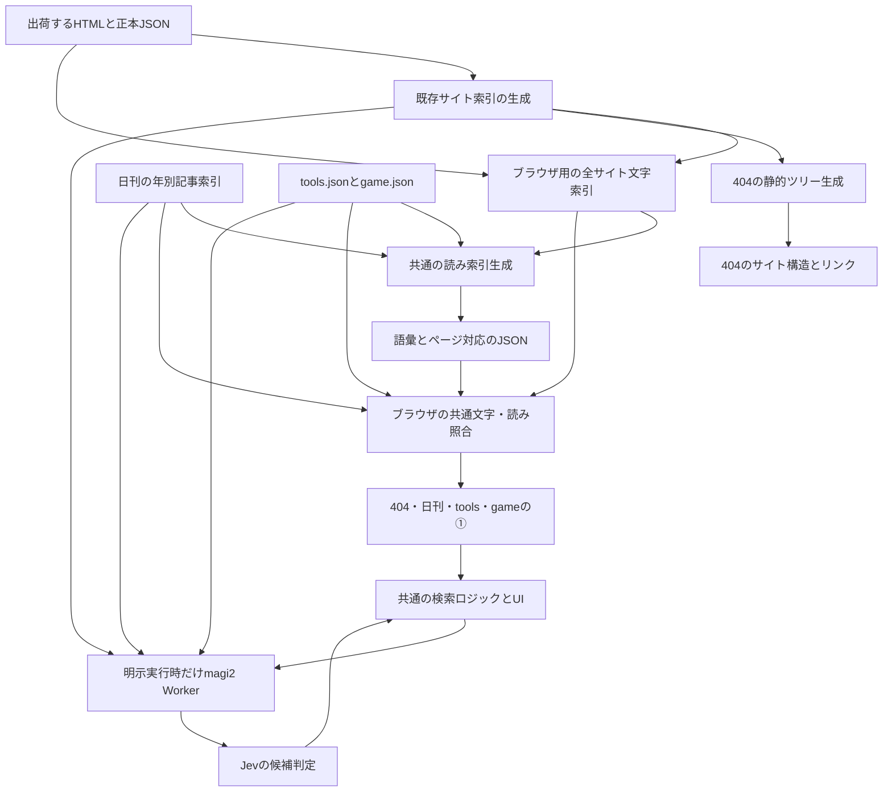

# サイト内検索 Phase 4 設計書

実装中（2026-10-12更新）。未公開。基盤の実装とローカル検証は[実装記録](../.github/site-search/phase4/implementation-progress.md)。要件は[PRD](site-search-phase4-prd.md)、順序は[実装計画書](site-search-phase4-plan.md)、合否は[検証計画書](site-search-phase4-verification.md)。Phase 0〜3の公開記録は保持する。

## 1. 構成と正本



読み生成は公開用ビルドに集約する。日刊の既存記事生成・履歴保存の前には辞書処理を追加しない。1つの生成器が各画面の基礎データを解析し、読みJSONの形式と解析器を共通にする。語彙は各ファイル内で共有する。

`build.sh`の順序は、公開ファイルのコピーとreverse-recaptchaのビルド→既存サイト索引→ブラウザ用文字・読み索引→静的ツリーの埋め込み→最終出荷検査とする。新しい生成処理は既存の最終検査より前に置く。生成後のJSONと書き換えた404を含め、必要ファイル・公開範囲・参照・索引契約・1ファイル25MiBと全体20,000件の上限を検査する。検査後に出荷物を書き換えない。

| 役割 | 正本・配置案 |
| --- | --- |
| 公開対象・通常ページの文章 | 既存 `.github/scripts/site-search-index.py` と出荷HTML、tools/game/glitchの正本JSON |
| 404①のブラウザ用基礎索引 | `search-reading-index.py`で `_site/data/site-keyword.json`を生成。公開ページ集合と既存①の全文の検索項目を合わせる |
| 主要入口の日英名・明示noindex例外 | `404.html`の`data-entry`リンクを維持。ツリーへの移動でIDを変えない |
| 読み生成・語の選び方・シリアライズ | 新規 `.github/scripts/japanese_search.py` |
| 出荷用の呼び出し | 新規 `.github/scripts/search-reading-index.py`、`build.sh` |
| Python依存の版・配布物ハッシュ | 新規 `.github/scripts/search-reading-requirements.txt`。辞書・解析器とも固定 |
| 必要な読みの補正 | 新規 `config/search-readings.json`。表記・読み・根拠を持つ。privateなconfig自体はサイトに出さない |
| ブラウザの共通照合 | 新規 `assets/japanese-search.js`、`window.STJapaneseSearch` |
| 固定ソース取得・検査 | `assets/search-data.js`。256KiB以上のJSONは`assets/search-json-worker.js`をBlob Workerとして起動し、生バイトhashの計算と解析を行う。失敗時用の同じバイト列を保持し、解析側へArrayBufferを移譲する。値・ID順を保持し、最大64項目ずつ受け取る。Workerが使えない場合は保持したバイト列の主スレッド処理へ縮退。辞書と通信はWorkerへ持たせない |
| 4画面の検索制御とUI | 新規 `assets/search-ui.js`・`assets/search-ui.css`、`window.STSearchUI`。①②の状態・IME・候補・描画・復帰の正本 |
| ②の共通通信と応答検査 | 既存 `assets/site-search.js`を拡張。scope別の生応答を共通内部形式へ変換 |
| Workerのscope・候補・判定 | `workers/magi2/search-scope.js`・`site-rank.js`・`src/index.js`。設定は`personas.js`の`SITE_RANK`、有効化は`wrangler.toml` |
| 404のツリー生成 | 新規 `.github/scripts/search-tree.py`。主な入口定義と公開ページ集合を入力 |
| 404の呼び出し・状態・表示 | `404.html`。文字・読みの部品と静的ツリーを使う |
| 日刊・一覧の呼び出し | `job/assets/daily-ui.js`、`tools/index.html`、`game/index.html` |

分割した準備の再開は、対応ブラウザでは`STJapaneseSearch.yieldControl()`から`postTask`のbackgroundを使う。未対応では既存のタイマーへ縮退し、文字検索と読み採用を保つ。優先度の参考は[Scheduling APIの仕様](https://wicg.github.io/scheduling-apis/#task-and-continuation-priorities)。辞書・照合結果・復帰回数・Jev実行条件は変えない。

既存の `data/site-search.json` と日刊 `search-index*.json` に読みの列を足さない。Workerの検査・index hash・日刊generationと、ブラウザ用の補助データを分ける。既存scopeの候補選び・Jevへ送る項目・精度fixtureは保持し、tools/gameのscopeを共通Workerへ追加する。モデルIDの正本は引き続き`config/ai-models.json`。実装前に`.github/JEV.md`を読み、利用箇所・評価・smokeを更新する。

## 2. 生成時の形態素解析

### 2.1 解析器

SudachiPyとSudachiDict-coreを第一候補とする。Python APIの `surface()`・`reading_form()`・品詞を使い、各語の実際の表記と読みを取得する。[公式APIの例](https://github.com/WorksApplications/sudachi.rs/tree/develop/python)

P4-T02で現在の配布版・Python/Pages環境対応・解析器と辞書それぞれのライセンス・生成した読みの公開条件を確認し、正確な版とSHA-256を依存ファイルへ固定する。辞書の大きさをブラウザの転送量として数えない。Pagesの依存取得時間・辞書展開容量・ビルド時間は別に測る。ローカルとCIで同じ固定版を使い、実行ごとのlatest取得はしない。

現在の `build.sh` はPythonパッケージの導入を行わないので、固定依存の導入ステップとCIキャッシュを実装作業に含める。ルートのPython導入ファイル等、配置によって公開されるファイルを増やさず、`.github/scripts/`内に置く。

### 2.2 語の抽出

1. PRD2.1の各検索フィールドを別々に読む。解析前はNFKCと禁止制御文字の除去まで行い、漢字・ひらがな・カタカナの表記を保って解析器へ渡す。かなの統一は抽出後の表記・読みの照合用の値に対して行う。元の表示用文字列は保持する。[Unicode正規化](https://www.unicode.org/reports/tr15/)
2. SudachiのB分割を基本に、C分割の複合語も保持する。同じ語の重複は除く。名詞・動詞・形容詞・副詞等の内容語を読みの対象にし、助詞・助動詞だけの読みは候補を広げるための語にしない。文字一致からは取り除かない。
3. 「ニトリ」「家電」のような語のほか、題名・タグの連続したかな語は直接読みにできる。未知語の読みが空でも、かなの表記自体は利用する。
4. 活用語は元の読みと辞書形の読みを、辞書が提供できる範囲で持つ。異なる語の境界や異なるフィールドを連結して新しい語を作らない。
5. 補正辞書は実在する表記への読みの追加・修正だけに使う。意味の言い換えや、記事にない事実の生成には使わない。同じ表記に複数の読みがある場合は区別して保持する。
6. 未解決の漢字・固有名詞は表記の文字検索に残す。語の欠けと原因を生成のレポートへ出す。人名等の読みを推測して確定しない。

空の文章・英語だけのページも正常な入力とする。例示語だけの手書き辞書へ置き換えない。LLM・翻訳API・検索APIへの追加呼び出しは不要。

### 2.3 最終成果物と再現性

出荷先と対応する基礎データは次のとおり。各読みファイルは4.1の共通形式で作り、基礎データ1つのバイト列と照合する。生成物は手編集しない。

| 画面 | `_site`内の基礎データ | 読みファイル |
| --- | --- | --- |
| 404 | `data/site-keyword.json` | `data/site-readings.json` |
| ツール一覧 | `data/tools.json` | `data/tools-readings.json` |
| ゲーム一覧 | `data/game.json` | `data/game-readings.json` |
| 日刊各年度 | `job/<media>/search-index*.json` | `job/<media>/search-readings-<YYYY>.json`。年の一覧は4.2のmanifest |

404の基礎索引 `_site/data/site-keyword.json`も同時に生成する。掲載対象・ID・URL・表示名は既存サイト索引から取り、tools/game/glitchの既存①の検索用の題名・説明・短い説明・タグ・ジャンルを正本JSONから補う。説明を短縮するのは表示用だけで、文字照合用は保持する。既存のサイト索引は説明320文字・detail640文字へ短縮し、短い説明を優先するため、それだけを①の正本にすると将来の長い説明の検索が欠けうる。Worker用索引の契約を広げずに、ブラウザ用索引で防ぐ。

同じ入力・辞書・補正・正規化revisionから同じUTF-8/LFバイト列を作る。並びは明示的にソートし、時刻は内容に入れない。生成の依存識別子は公開JSONに記録する。書き込みは一時ファイルで検査してから置き換える。

通常ページの旧索引と読みが不整合なまま公開されないよう、出荷ビルドで全ファイルの照合を行う。生成の依存不足・不正な対応・上限超過はビルドを止める。辞書にない個別の語は警告と文字一致の保持で扱い、媒体全体の索引を不正扱いしない。

## 3. ブラウザの入力と照合

### 3.1 入力の扱い

入力の正規化は照合用のコピーに対して行う。NFKCと小文字化の後、確定しているかなと未完成のローマ字を扱う。`bind()`等で入力欄に独自IMEを付けない。

| 入力例 | 内部の状態の例 | 読み候補 |
| --- | --- | --- |
| `ｎ` | 未確定の`n`。`ん`の可能性も残す | に・な等を先頭に持つ語／んで始まる語 |
| `にｔ` | 確定した`に`＋未確定の`t` | にとり等 |
| `かでｎ` | `かで`＋`n`／`ん` | かでん等 |
| `shi`・`si` | し | しで始まる語 |

通常のIMEの入力差を扱うかな・ローマ字の変換表を共通部品に持つ。ヘボン式・訓令式（shi/si、chi/ti、tsu/tu、fu/hu）、拗音の別表記、促音の子音重ね、`n`/`nn`/`n'`の曖昧さ、長音の表記を検証セットへ固定する。かな語の長音は辞書の読みを正本とし、辞書が確定する通常の母音表記を補助候補にする。すべての母音・長音を無条件に同一視しない。

末尾の未完成子音を含む入力は、かなへ変換できた部分と残りの許される入力列で読みの接頭部を照合する。複数の解釈は有限状態として照合し、語ごとのローマ字全組合せを索引へ列挙しない。ブラウザ向け変換表に既存ライブラリを採用する場合は、公式配布・ライセンス・純粋な変換APIを確認し、既存vendor取り込みスクリプトと `--check` を通す。CDN参照・独自IMEのイベント登録・unsafe-evalは追加しない。

漢字を含む入力は、まず元の文字一致で調べる。読み辞書の表記と一致する既知の漢字語は、同じ語の読みへの照合にも使える。未知の漢字混在入力をブラウザで新たに形態素解析するとは定義しない。文字一致を失わない。

### 3.2 共通API案

`STJapaneseSearch.prepare(records, fields)`で各レコードの文字照合用の値を1回だけ作る。読みJSONの検査後に`attachReadings()`で語彙・対応を加える。`search(query, filters)`は同じレコードID、件数、文字／読みとフィールドによる順位の情報を返す。表示・リンクの生成・API送信・計測・IMEの状態は呼び出し元が受け持つ。

文字・読みの正規化、空白区切りの複数語AND、順位は4画面で共通にする。各語の文字部分一致または読み前方一致をレコード単位で交差する。旧日刊の`recordText`の連結・空白除去、旧一覧のフィールド連結などで得られた文字一致は、共通部品内の設定された互換照合でも拾い、IDで和集合を取る。互換照合は結果を保持する補助であり、画面ごとに別の検索アルゴリズムを残す意味ではない。フィールド名・互換用の連結規則・安定順だけをadapterに宣言し、同じfixtureで旧文字一致が残ることと新しい複数語ANDを検証する。

`compositionupdate`・`input`・`compositionend`で、実際に見えている入力値から候補を更新する。イベント順序の違いはanimation frame単位でまとめる。`compositionupdate.data`を入力欄全体へ上書きしない。非同期取得の前にquery・filters・locale・世代を固定し、古い描画を破棄する。

読みの候補が途中で準備できても、現在の入力に対してだけ更新する。IME中は変換候補の上下・Enterを横取りしない。確定Enterの押し続けを検索へ転用しない。フォーカスと選択範囲を維持する。

文字検索の利用可否と読みの状態（未取得・準備中・利用可能・失敗）を別に持つ。案内と0件の扱いはPRD5章に従い、状態の変更を入力ごとに読み上げず通知をまとめる。サジェストと全候補一覧は同じ検索結果を使い、先頭6件だけをサジェストへ描く。全候補一覧への操作は既存のEnterによる②実行と分け、①の範囲で表示する。

4画面の①の一覧は、現在の条件で一致した全件を保持し、表示上限を100件から始めて追加表示のたびに100件増やす。①②の重複除去は表示上限を適用する前に行い、②に出た項目を除いても表示枠を補う。総一致件数は従来どおり重複除去前、一覧の表示件数と残り件数は除去後の集合から求める。最後まで表示したら追加操作を終了する。日刊の既存の`matched.slice(0, 100)`による打ち切りと「先頭100件のみ」の案内は、この追加表示へ置き換える。

「全候補を見る」「さらに100件表示」は`type="button"`のローカル操作とし、フォーム送信・`rank.run()`・③・追加の検索語計測を起動しない。入力・filters・locale・採用した基礎索引が変わったら全件を再集計し、表示上限を100へ戻す。②の応答だけで表示上限を戻さない。追加表示時は既存行を不要に作り直さず、ボタンと結果のフォーカスを保持する。IME中の操作制約は既存の検索実行と同じく守る。

### 3.3 順位と既存①

文字の適合度を保持し、読みを追加する。PRD3.3のフィールド別の順位を使う。ASCIIだけの1文字の説明一致は、日本語読みの一致より下に置く。この変更で文字で見つかったレコード自体を落とさない。

4画面の既定の関連順は同じ適合度を使い、日刊の新しい順などは同点時の安定順として設定する。tools/gameの既存の並べ替えは利用者が選ぶ①の比較規則として共通部品へ渡し、②の確率順は変更しない。読みで一致した①にも、②と同じURL・記事アンカーの重複除去を適用する。合計件数は重複除去前の①の件数を使う。

### 3.4 検索制御とUIの共通部品

`STSearchUI.mount(container, adapter)`を4画面の唯一の検索制御入口にする。adapterは`scope`・対象名・locale・基礎データと読みの取得／検査・検索フィールド・許すfilters・①の比較規則・安全なリンク・計測の接続を宣言する。入力、IME、サジェスト、全候補、100件ずつの追加表示、①②の重複、非同期の世代、復帰、中止、状態の文言とDOMは共通部品が持つ。adapterに独立した検索処理や結果テンプレートを持たせない。

`japanese-search.js`は純粋な文字・読み照合、`site-search.js`は②の送信と検査、`search-ui.js`は両者の連携と描画を担当する。新UIの②の描画は共通UIに集約し、通信部品とページ側で二重に描画しない。内部結果は`{scope, query, locale, filters, dataRevision, status, rows, total, candidates, judged, complete, cached}`へ揃える。各行は検査済みのID・URL・題名・説明・種類だけを持つ。状態は①の取得・読みの準備・②のidle/loading/results/no_results/failed/staleを独立に持ち、一方の失敗で他方を消さない。

新UI用には`STSiteSearch.createRankClient()`と`readRankResponse()`を追加する。新入口・新応答の検査を担当し、描画・DOMイベント・計測を持たず、結果を共通UIへ返す。既存の`STSiteSearch.rank({elements, labels, ...})`と`readResponse()`は旧HTML向けの互換APIとして保持する。旧APIの引数・返り値、`run/invalidate/cancel/settled/hrefs`・`state/disabled`、描画・状態通知・計測とコールバック、旧入口・旧応答の検査を維持する。旧APIは`search-ui.js`／CSSの追加読み込みなしで動作させ、旧HTMLに新しい初期化を要求しない。通信の共通処理は共有できるが、新旧の入口・応答契約は明示的に分ける。

旧APIに残す描画は旧画面だけの互換処理であり、4画面の新UIからは呼ばない。`?v=`はキャッシュ対策であって旧JSの保存ではないので、古い404・日刊HTMLが旧版のquery付きURLから新しい`site-search.js`を取得する組み合わせを検証する。共通JS/CSSと全HTMLを同じpushで更新しても、この互換検証を省略しない。

DOMは共通の入力欄・検索ボタン、listboxのサジェストと件数／全候補ボタン、filtersの共通枠、①②の同じ結果行、状態と中止、追加表示、プライバシー説明から作る。色・寸法・余白・フォーカス・日英文言は`search-ui.css`と共通辞書を正本にし、ページ固有CSSで結果だけ別のカードにしない。scopeで必要なfiltersやsort選択肢を差し替えることは許す。検索語が空のtools/gameの通常カタログは外側に残し、検索時は共通の結果領域を使って別の検索結果一覧を二重に出さない。

Enter／検索ボタンの明示操作は現在の条件を固定して①を表示し、②を1回だけ送る。①の準備は②のtimeoutに含めず、遅い読みの準備を②の必須条件にしない。入力・IME・filters・locale・sortの変更は②をinvalidateする。sort・追加表示・全候補・受け渡し・自動復帰は②を送らない。③は404の既存機能を追加操作として接続し、開始時に共通の②を中止する。入力の変化を新しいJev要求へ自動変換しない。

## 4. 読みJSONの契約

### 4.1 基本の形

```json
{
  "version": 1,
  "source_sha256": "基礎索引の実際のバイト列のSHA-256",
  "generation": "ソース・解析器・辞書・補正・revisionから生成する識別子",
  "normalization_revision": 1,
  "analyzer": {"package": "固定版を記録", "dictionary": "固定版を記録", "aliases_sha256": "実際の値"},
  "record_ids": ["page:dj", "page:thought"],
  "terms": [{"surface": "家電", "reading": "かでん", "postings": [[0, 1]]}]
}
```

上は形式例で、ハッシュの仮文字列を実データとして使わない。`postings`の第1要素は`record_ids`への参照、第2要素は題名・タグ・説明等のフィールドのビット集合。表記＋読みを語彙の一意キーにし、同じ語・同じレコードの重複はまとめる。語彙は読み順でソートし、ブラウザでは二分探索で接頭部に一致する範囲を求める方式から始める。1文字でも範囲を途中で打ち切って件数や候補を落とさない。PRDの性能条件を満たせない場合だけ、トライ等を比較して採用する。正規化した全文や、語の全接頭辞は保存しない。

`record_ids`は、各画面が基礎データを既存の規則で検査・整形した後のID順と完全一致させる。生成側とブラウザ側の採用規則をfixtureで固定し、異なる順へ読みを当てない。通常ページはサイト索引のID、一覧は種類と正本ID、日刊は媒体・号の日付・`#art-N`を使う。`terms`にURLやHTMLを入れず、検索結果のURLは基礎データからのみ取り出す。`source_sha256`の照合は整形前の実際のバイト列に対して行う。

### 4.2 日刊のmanifestと取得

manifestは`version`・`media`・`source_generation`・読みの`generation`・`normalization_revision`・`files`を持つ。各fileは年、基礎索引の相対名とSHA-256、読みファイルの相対名とSHA-256、レコード数を持つ。年は既存headの`years`と一致し、最新の年は`search-index.json`、過年度は`search-index-<年>.json`に対応する。

file名はその媒体内の固定規則から求め、manifestの値と完全一致させる。絶対URL・遡り・query/hash・別媒体のパス・年度の重複を拒否し、未検査のfile名へfetchしない。年別読みは同じ媒体の`search-readings-<YYYY>.json`だけを取得する。

基礎索引が全年度そろった後、読みも全年度を取得・検査する。並列は既存の日刊索引と同程度に制限し、読み側にも本文サイズ・語数・対応数・期限の上限を置く。超過は読みの利用停止として扱い、既存Workerの8MiB上限を緩めない。上限値はP4-T02の測定とPRD5章を根拠に固定する。

元の生バイト列とmanifestをWeb CryptoのSHA-256で照合し、generation・年度・媒体・ID・対応の範囲を検査する。通信キャッシュが新旧を混ぜた場合は読みを採用せず、文字検索を維持する。復帰は4.4の共通手順を使う。旧画面は新しい読みファイルを使わないため、既存の文字検索を続けられる。

### 4.3 通常ページと一覧

404は同一サイトの`data/site-keyword.json`を①に使用し、そこから表示名・説明・検索フィールド・安全なURLを取り出す。読みの`source_sha256`はこのブラウザ用基礎索引の生バイト列へ対応させる。基礎索引が成功すれば文字検索を利用可能にし、読みは独立して追加する。取得失敗では既存3一覧による文字検索を縮退用として残し、「一部のページを検索できません」と表示する。3一覧の取得状態をサイト全体の取得成功として扱わない。

基礎索引も信頼済みのHTMLとして扱わない。schema・kind・IDの一意性・文字列の型と長さを検査し、URLは`https://tk.st`内の公開ページへのルート相対パスだけを採る。プロトコル相対・外部origin・認証情報・不正なport・遡り・制御文字・バックスラッシュ・検索語を含むquery/hashを拒否する。日刊記事のアンカーは既存の専用検査を使う。タイトル・説明は`textContent`、出荷ツリーはHTML/属性をエスケープして描く。不正な1行は採用せず、検索の一部欠けとして分かる状態にする。

不正行を除いた基礎索引には読みの対応を適用しない。行の除去で位置がずれた参照を別ページへ結び付けず、採用できた行だけの文字検索を使う。縮退用3一覧の取得は全サイト索引が使えないときだけ行い、正常時に4種類の索引を常に待たない。

ブラウザ用基礎索引にもschema・フィールドの長さ・合計バイト数の上限を設けるが、既存①の正常な検索項目を黙って切り捨てない。上限と現在の値はT02で測って固定する。読みの失敗でも、文字検索用の全文の項目は基礎索引に残る。追加容量は読みJSONだけでなく、この基礎索引も含めて測る。

tools/gameは正本JSONと、それぞれの読みファイルを読む。404の基礎索引・読みファイルは取得せず、ブラウザで複数ソースのhashやURLの写像を照合しない。4.1の共通検査で、自分の基礎データとID順が一致した読みだけを採用する。現在の検索フィールド（ゲームの`ai`等も含む）と並べ替えの選択肢を共通部品の設定へ移す。索引間の一部の語彙は重複するが、一覧の依存と取得量を減らせる。追加分の総容量はPRD5章の同じ上限で検証する。

②のためにtools/gameのブラウザが全サイト索引を取得する必要はない。Worker側が検査済みの公開索引と一覧を読む。並べ替えは3.3の共通部品の設定へ移す。

### 4.4 版ずれからの復帰

1. `source_sha256`・日刊generation・年度集合が不一致なら読みを外し、検知時に自動復帰を開始する。404・日刊・tools/gameで同じ規則を使い、利用者の明示操作は待たない。未対応schema/revision・不正な対応・サイズ超過などの契約違反は無理に採用せず、文字検索へ縮退する。
2. その画面の基礎データと読みを1組として再取得する。日刊はheadと年別基礎索引のPromiseキャッシュも無効にし、新しいheadの年度集合でmanifestと読みを取得する。404・一覧も読みだけでなく対応する基礎JSONを取り直す。
3. 再取得はHTTPキャッシュを再検証する設定で行い、復帰処理は画面の初期化から再読み込みまで1回だけに制限する。開始前に実施済み状態と共有Promiseを設定し、同時の不一致検知は同じ処理を待つ。入力・filters・locale・検索実行・追加表示・基礎索引の採用によって回数を戻さない。再取得中や再取得後の不一致・取得失敗から復帰処理を再帰的に起動せず、定期再試行や専用の再試行ボタンも追加しない。版ずれを検査できない取得失敗では文字検索を続け、ページの再読み込みで通常の初期取得からやり直せる。
4. 新しい基礎データが検査を通ったら旧読みを外して文字検索へ採用し、読みはその基礎データとの照合が完了してから付ける。基礎データの再取得自体が失敗した場合は、最後に検査を通った文字検索を残す。旧基礎データへ新しい読みを途中で結び付けない。
5. 復帰中も検査済みの文字検索を使えるようにする。データ取得の完了時に画面・索引の世代を確認し、最新のquery・filters・localeで候補を再計算する。入力条件が変わっても共有する復帰処理をやり直さず、古い条件の描画を破棄する。入力値とフォーカスを保ち、古い非同期応答・古い索引に対する②の結果は新しい一覧へ適用しない。復帰処理自体から②③や検索語の計測を送信しない。

### 4.5 Jev検索のscopeとWorker契約

新UIの固定入口は同一サイトの`POST /search/api/rank`。magi2へ`tk.st/search/api/*`のrouteを追加し、この正確なパス・POST・`mode=rank`だけを既存の②ハンドラーへ渡す。③やチャットへ転用せず、不正なpath/method/modeはAIと利用回数を使う前に拒否する。既存`workers.tk.st/magi2/site-search`と古いsite／日刊画面の契約は維持する。認可・Origin確認・body上限・deadline・no-store・利用回数は既存②と同じ処理を使い、別のJev呼び出し実装を増やさない。

新入口は`{search_contract: 1, mode: "rank", scope, query, locale, filters?, generation?}`を受ける。scopeと許すfiltersは固定表で検査し、不明scope・余計なfield・不正値は400で拒否する。旧入口の旧契約では引き続きsite・nitori・retailだけを受け、tools/gameの400を含むPhase 3の契約を維持する。新scopeは新入口からだけ利用でき、入口の契約検査後は同じ②の共通処理へ渡す。クライアントから候補・URL・モデル・閾値・候補上限を指定させない。

| scope | Workerが取得する正本 | 候補とfilters | generation |
| --- | --- | --- | --- |
| `site` | 既存`data/site-search.json` | 既存の公開ページ集合。日刊の号は②から除外。filtersなし | 既存snapshotの本文hash |
| `nitori`・`retail` | 既存の媒体別全年度索引 | 既存の記事、category・region・month | 既存の媒体generation |
| `tools` | 固定URLの`data/tools.json`と検査済み`data/site-search.json` | 公開索引とID・URL・候補項目が対応するtoolだけ。category | 一覧JSONの生バイト列のSHA-256 |
| `game` | 固定URLの`data/game.json`と検査済み`data/site-search.json` | 公開索引とID・URL・候補項目が対応するgameだけ。genre | 一覧JSONの生バイト列のSHA-256 |

取得先は`search-scope.js`の固定表から決める。tools/gameの公開候補は既存`toRankCandidate()`の項目を使い、一覧と公開索引で題名・タグ・カテゴリー・ジャンル・表示用説明の生成規則が一致することを検査する。categoryの大小文字などは共通の写像で揃える。新旧混在を検知したら`index_updating`としてJevを呼ばない。noindex・転送・別canonical・欠落ページは候補へ足さず、対象集合と除外理由を生成側でも記録する。

候補選択より前にscopeとfiltersを適用し、別区画やfilters外の正解が枠を消費しないようにする。候補選択は共通の関数に集約し、検索フィールド・上限・同点順・補充順をscope設定として渡す。tools/gameは対象集合内の文字適合度によるshortlistを使い、上限は各20件を初期候補として評価で固定する。文字一致が少ない場合の補充は正本IDによる決定的な順とし、正解が候補へ入る割合も評価する。siteの全対象と日刊の文字一致＋新しい記事による補充は設定で再現し、既存の候補ID集合・順をfixtureで維持する。scopeごとに同じ選択処理をコピーしない。候補変換・1回にまとめたnoul・確率検査・閾値・上位5件・URL照合も既存②の共通経路を再利用する。

新scopeの設定は`SITE_RANK.scopes.tools`・`.game`にrevision・候補上限・問い・閾値を持つ。siteの基準付きの問いと0.4は評価開始時の比較候補であり、合格値と決めつけない。問いや候補変換・閾値を変えたら該当scopeのrevisionを上げる。結果のkindとURLはWorkerとブラウザの双方でtool→`/tools/`、game→`/game/`の公開対象と照合し、JevからURLを作らない。

新入口の応答は`{status, reason?, complete, cached, searched, results}`へ揃え、`searched`にscope・検査済みfilters・generation・total・candidates・judgedを含める。snapshot取得前の失敗では`searched=null`。generationの形式はsite／一覧の64桁hashと日刊の既存generationをscope別に検査する。件数の大小関係、候補上限、行の重複、kind・URL・scope・条件の一致を共通検査する。`complete`は選んだ候補をすべて判定できた意味であり、全掲載項目を判定した意味にはしない。旧入口の応答形式は維持し、新入口の形式への変換はハンドラー境界で行う。

新入口では、クライアントのgenerationと検査済みsnapshotのgenerationを、利用回数の加算・判定結果キャッシュの採用・Jev呼び出しより前に照合する。現行siteの`getSiteSnapshot()`は10分間のキャッシュを持ち、期限後も古い版を返して裏で更新するため、新入口で版が違う要求をこの経路へそのまま流さない。次の手順をsite・日刊・tools/gameへ共通に適用する。旧入口のキャッシュ・generation契約は維持する。

1. generation不一致または一覧と公開索引の混在を検知したら、そのscopeの固定ソースをHTTPキャッシュの再検証付きで取り直す。tools/gameは一覧と公開索引を同じ更新処理で検査する。1要求につき更新処理は最大1回とし、取得後も不一致なら再帰的に更新しない。
2. 更新中のPromiseと再取得を許す時刻をWorkerのキャッシュ状態で共有する。同じソースの通常の裏更新が既に動いていれば、その完了を要求の期限内で待ち、同時要求から別の更新を始めない。重複するソースの更新も共有し、遅れて完了した旧取得で新snapshotを上書きしない。ある要求の中断で他の要求が待つ共有更新を中止しない。更新開始時に少なくとも`SITE_SEARCH.list_retry_ms`の間隔制限を設定し、偽のgenerationや連打でも毎回fetchしない。共有の待ちと再取得を既存の取得・要求の期限内に収める。
3. 検査を通ったsnapshotを原子的に採用して再照合する。一致すれば同じ明示要求の中で通常の②へ進み、Jevは最大1回。待ち・間隔制限・取得失敗・再照合で未解消ならHTTP200で`status=failed`・`reason=index_updating`・`complete=false`・`cached=false`・`results=[]`を返し、IP／全体の利用回数を加算せず、Jevや古い判定結果を使わない。検査済みsnapshotがある場合の`searched`にはそのgeneration・scope・filters・totalと`candidates=judged=0`を載せ、無い場合は`searched=null`とする。世代を指定しない要求でも、検知済みのソース混在を古い候補で処理しない。

新UIはブラウザの基礎データから②用generationも取得して送る。404の`site-keyword.json`には元のサイト索引の本文hashを`rank_generation`として別に記録し、読み用の`source_sha256`と混同しない。一覧は自分のJSONの生バイト列hash、日刊は既存generationを使う。応答が`index_updating`なら`searched=null`でも、また応答generationが基礎データと異なる場合も、②を描画・重複除去へ採用せず4.4の自動復帰を共通の1回枠で行う。①だけを最新条件へ更新し、②は自動再送せず次の明示実行を待つ。Workerの更新処理はこの明示POST内の索引取得であり、ブラウザの復帰1回枠をリセットしたり②のPOSTを増やしたりしない。

キャッシュのキーにはscope・該当scopeのrevision・locale・正規化query／filters・index_hashを入れ、新入口の形式と旧応答を混ぜない。tools/gameのindex_hashは一覧と公開索引の両方の実取得本文を含み、candidate_hashはscope内の全対象の変換結果から作る。利用回数は既存のIP日次／全体日次の共有枠を使い、新scopeごとの追加枠を作らない。停止は`SITE_RANK_ENABLED`と`SITE_RANK_SCOPES`を使い、停止scopeは索引・回数・Jevを使わずdisabledを返す。公開時は`site,nitori,retail,tools,game`へ拡張する。

### 4.6 通信・プライバシーの接続

一覧の検索語は明示実行時だけ同一サイトの固定入口からWorkerを経由してTypeSafe AIへ渡る。送る候補はWorkerが取得した公開のメタデータであり、個別ツールに入力したファイル・QR内容・処理結果・非公開データを集める機能は持たない。入力中のWorker通信0、固定JSON取得URLに検索語を載せないこと、受け渡し語のURL除去、解析停止と伏せ字を維持する。新しいイベント接続が必要な場合も共通の`search-analytics.js`を使い、IME途中値を追加送信しない。

tools一覧のCSPは同一サイトの`connect-src 'self'`で新入口を使い、TypeSafe APIや新しい外部originを許さない。ただし同一サイト経由でも検索語がTypeSafe AIへ渡る事実は一覧の本文・FAQ・JSON-LD・プライバシー説明へ反映する。個別SAFE TOOLSのCSPと「中身を送る処理を持たない＋通信先を制限する」の説明は維持する。共通JSはユーザーが明示していないデータを集めず、Clarity禁止も維持する。

TypeSafeのnoul、入力の扱い、料金・上限は`.github/JEV.md`を参照する。2026-10-11の資料更新時に[公式noul](https://docs.typesafe.ai/primitives/noul)、[プライバシーポリシー](https://typesafe.ai/legal/privacy-policy)、[モデル資料](https://docs.typesafe.ai/models)を参照した。公開時にも確認し、学習・保持期間・処理場所を共通の説明へ反映する。2026-10-12に新scopeの実Jev評価を実行し、条件・閾値・残る誤候補を[評価記録](../.github/site-search/phase4/rank/README.md)へ記録した。

## 5. 404のツリー

### 5.1 階層と生成

サイト索引のページ集合と既存の主要入口定義を使い、URLの最も近い掲載親ページの下へ置く。ホームを根にし、第一階層はURLの区画の昇順を基本にする。特定の4区画を先に置く優先値を作らない。日刊は`/job/`の子で、号は媒体→年→月の下に置き、新しい号を先にする。

中間パスに掲載ページがない場合は、リンクのないグループを作る。noindexの実在ページを「親だから」という理由で追加しない。未定義の新しい公開区画も、同じ階層の枝として追加する。ラベルは索引の題名を使い、主要入口では404の定義を優先する。無意味なURLフォルダー名を説明文の代わりにする場合は生成レポートで確認できるようにする。

生成したHTMLは `_site/404.html` の明示したツリー領域へ埋め込む。ルートの`404.html`には第一階層・日刊入口などの正本リンクと、生成領域の境界を置く。子ページは出荷ビルドで生成し、生成結果を手で編集しない。既存の`data-entry`は主要入口のリンクにだけ残し、すべての葉へ複製しない。

既存の「URLの誤りから候補を出す」処理は、主な入口と全サイトの項目を使って保持する。カードのIDに結び付いた到着区画の自動展開は、URLの祖先の枝の開閉へ置き換える。実際に存在する号だけを案内するHEAD検査を維持する。

### 5.2 HTMLと操作

`nav`内のネストした`ul`/`li`と通常の`a`を基本とする。子を持つ枝には`details`/`summary`を使い、ページへのリンクはsummaryの外に置く。リンクと開閉のクリック領域・Tab停止を分ける。リンクなしの年・月はsummaryだけでよい。

見た目はツリーだが、`role="tree"`を付けてデスクトップアプリ型の複雑な矢印操作を要求しない。通常のリンク・開閉としてキーボードと読み上げを使える構成にする。[WAIの階層ナビゲーションの考え方](https://www.w3.org/WAI/ARIA/apg/patterns/disclosure/examples/disclosure-navigation/)

同じ深さは共通のCSSを使う。深さでインデントし、子がある枝の開閉と件数を同じ位置に置く。罫線はCSSで描く。長い日本語・英語の題名は折り返し、320pxでも横スクロールさせない。リンクのタップ領域は44px相当を目標とする。

初期状態は根と第一階層を見せ、到着区画の祖先を開く。すべての子は静的HTMLにあり、JS無効でも開ける。年別・月別の折りたたみで日刊の号の長い一覧を抑える。大規模fixtureでHTML量・DOM初期化・枝の開閉を測り、制限を超える場合は公開前に生成構成を見直す。

## 6. 変更する既存ファイルと互換性

| ファイル | 変更点 |
| --- | --- |
| `404.html` | 共通検索UIへの接続、全サイト取得、ツリー、③の追加操作 |
| `job/assets/daily-ui.js` | ①②の個別制御・描画を共通部品へ移し、媒体adapter・既存本文機能だけを保持 |
| `tools/index.html`・`game/index.html` | 共通検索UI・①②・scope filters・並べ替え・検索語の送信説明。通常カタログは維持 |
| `assets/site-search.js`・`assets/search-analytics.js` | 新UI向けの描画なしの通信API・新応答検査・計測接続。旧HTML向けrank/readResponseと描画契約を維持 |
| `workers/magi2/search-scope.js`・`site-rank.js`・`src/index.js`・`personas.js`・`wrangler.toml` | tools/gameのscope、固定入口、共通②への接続、設定・評価・停止 |
| `.github/scripts/daily_engine.py` | 共通JS/CSSの読み込み・版の定数と検索領域テンプレート。記事の正規化・検索語生成・履歴は維持 |
| `build.sh` | 固定依存と読み・ツリーの生成、出荷検査 |
| `.github/workflows/`の対象検証workflow | 新しい生成契約を固定依存で検証。botのpush規則を保持 |
| `AGENTS.md`・運用README・`.github/JEV.md`・`.github/AI_MODELS.md` | Phase 4の正本・生成物・検索scope・同一サイトの入口・利用箇所・評価・復帰方法を公開前に更新 |

Workerの本体とwranglerを変更して、新入口・tools/gameのscopeを公開する。旧入口・既存3scopeの契約と旧HTML＋新JSの組み合わせは回帰で確認する。新入口はWorker旧版／ブラウザ新版とその逆のgeneration不一致・更新共有・間隔制限・未解消時の利用回数／Jevゼロを検証する。新scopeには別の正解fixture・Jev評価・本番smokeを必要とする。既存48件の速度測定を機械的に再実施する必要はないが、既存経路の候補・問い・閾値が変わるならrevisionと影響した評価を更新する。

## 7. 公開と復帰

公開単位と全号の再生成は[実装計画書4〜5章](site-search-phase4-plan.md)、証跡は[検証計画書7章](site-search-phase4-verification.md)を正本とする。公開前のビルド失敗では前のPagesを保持する。公開後の読みの故障は自動的に文字検索へ縮退し、版全体の復帰は以前のPagesへ戻す。読みを止める専用の設定機能は追加しない。Jevの媒体停止設定は①へ転用しない。
