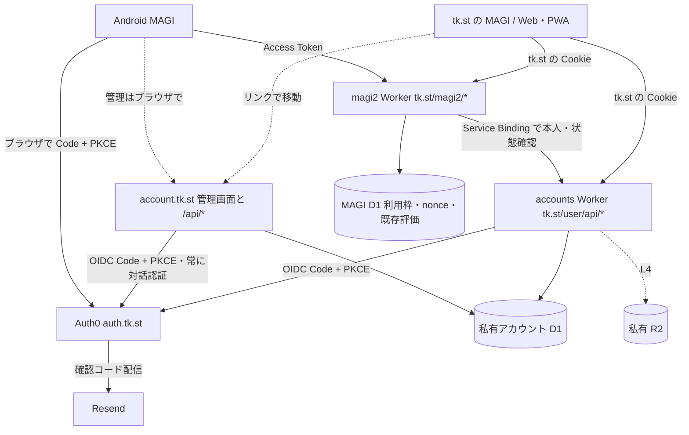

# tk.st / MAGI ログイン設計書

設計案（2026-10-25、2026-10-26 改訂）。未実装・未公開。本人指定は Auth0 採用・アプリ間 SSO なし（2026-10-25）、対象を magi2 に限りSAFE TOOLS にログインを設けないこと・管理画面 `account.tk.st` を最初から設けること（2026-10-26）。主目的は便利さ、商用化は副目標（同日）。任意ログイン、利用枠、同期範囲、保持期間、期間の値は本書の提案。
実装・公開後は冒頭を「実装済み（日付）。正本はコード」に変更し、以後は更新しない。

対象はトップページの MAGI、Web/PWA、Android、magi2 Worker と新設アカウント基盤（`account.tk.st` を含む）。[検証計画書](magi2ログイン検証計画.md) と、一時チャット・パーソナライズの既存仕様を併用する。

## 1. 目的・指定事項・対象外

| ID | 区分 | 要件・方針 |
| --- | --- | --- |
| R01 | 本人指定 | 認証は Auth0。自作の Magic Link / WebAuthn サーバーは作らない |
| R02 | 本人指定 | アプリ間 SSO は省く。Web と Android は別クライアント・別セッションでログインする |
| R03 | 設計提案 | ログインは任意。公開ページ・SAFE TOOLS・検索の利用に登録を要求しない |
| R04 | 設計提案 | メール確認コード（Resend 配信）とパスキーを同一 Auth0 プロフィールで使う |
| R05 | 設計提案 | 本人の認証、アプリ内の所有者判定、利用制限を別の責務にする |
| R06 | 設計提案 | アカウント利用枠と、IP・全体の費用上限を併用する。アカウントの量産で枠を増やせないようにする |
| R07 | 設計提案 | ログイン・設定同期・履歴同期の同意を分ける。既存履歴を自動送信しない |
| R08 | 維持する制約 | 一時チャットは永続保存・同期しない。パーソナライズも適用しない |
| R09 | 設計提案 | アカウント切替・ログアウトで履歴、受信、保留データ、同期キューを混ぜない |
| R10 | 設計提案 | 旧画面・旧 APK はゲストとして継続。認証専用 API に旧 Origin/API キーの抜け道を作らない |
| R11 | 設計提案 | アカウント削除・書き出し・同期停止を提供し、削除の完了範囲を表示する |
| R12 | 維持する制約 | トップの外部アセット制限、tools の通信制限と「中身を送らない」約束、静的 HTML の構成を守る |
| R13 | 設計提案 | 認証情報・会話・個人設定を URL、アクセス解析、公開データ、診断ログに混入させない |
| R14 | 設計提案 | Worker 先行で段階公開し、停止時も既存の端末履歴と削除処理を保全する |
| R15 | 本人指定 | 対象は magi2。SAFE TOOLS（qr-palette を含む）・ゲーム・DJ などほかの区画にはログインを設けない |
| R16 | 本人指定 | 管理画面 `account.tk.st` を最初から設ける。一括書き出し・データ削除・退会・パスキー管理・（将来の）支払いの専用管理 API はここに限る。個別 API の反復で可能な操作の範囲は13.2に従う |
| R17 | 設計提案 | ログインと独立に、端末内の保存の強化（L0.5）を先に出す。ログインしない人にも効かせる |
| R18 | 設計提案 | 商用化は副目標。いま作るのは後から変えると高くつく備え（内部 ID、プランの列、規約同意の記録）だけ |
| R19 | 設計提案 | 通常のセッションは長めにして毎回のログインを求めない。危険な操作は `account.tk.st` の再認証で守る |

主目的は便利さ。具体的には、端末の保存が消えにくいこと、設定と履歴を端末間で引き継げること、ログインの手間が小さいこと。あわせて、利用枠の公平性と個別の利用停止を実現する。副目標は将来の商用化で、作り直しを避ける最小の備えに留める。同期には別途実装が必要で、ログインだけでは保存データの暗号化や不正利用の完全防止は実現しない。管理者権限、課金そのもの、ゲーム・DJ 管理画面・SAFE TOOLS への展開は対象外。

SAFE TOOLS にログインを設けない理由: 「中身を送らない」が価値の中心で、CSP・安全設計カード（`tools-ui.js` の `sendsSite === 0`）・FAQ・構造化データがその約束で組まれている。同期を足すと約束の書き換えが必要になる一方、揮発の多くは L0.5 と同じ手段（端末内の保存の強化・書き出し）で減らせる。qr-palette への適用は本書の対象外の別作業とする。将来どうしても端末間の同期が必要になった場合は、端末内で暗号化してサーバーが中身を読めない方式を別途検討する。

## 2. 現状

2026-10-25 の作業ツリーを参照。公開済みかどうかは公開記録で照合する。変更対象は4.2、保存説明は第13章にまとめる。

| 項目 | 現状 |
| --- | --- |
| 履歴・設定 | トップ/Web/PWA は localStorage、Android は `native-history.js` 経由のファイル。利用者別の分離・端末間同期なし |
| 揮発 | localStorage は容量が小さく、Safari はスクリプトが書いた保存領域を7日使われないと消す（ホーム画面の PWA は対象外）。書き出しの手段がない |
| Android 受信 | `native-background.js` と Conversation Plugin/Service/StreamStore が固定 URL の SSE を受け、途中データを保存・復旧 |
| Worker・DB | Origin/API キーで入口を許可し、IP・全体で回数を管理。`rate_limit`、`reactions`、`search_clicks` があり、評価しない通常本文は DB に保存しない |
| 音声キャッシュ | 本文の区切りのハッシュをキーにした Cache API。本人とは結び付けない。保持は `SPEECH.cache_seconds`（30日）、一時チャットはキャッシュしない |
| 通信・キャッシュ | Worker route は `workers.tk.st/magi2*` と `tk.st/search/api/*`。PWA はアプリ資産をキャッシュ。同一オリジンの個人 API は未実装 |

## 3. 段階・公開条件

| 段階 | 実装範囲 | 公開時に保存するもの |
| --- | --- | --- |
| L0 | Auth0 Free・メール OTP・パスキー・SSO 抑止・Android 復帰・iOS ホーム画面 PWA の往復・`account.tk.st` の配信の成立性確認 | 合成アカウントと試験結果のみ |
| L0.5 | 端末内の保存の強化（9.1）。ログイン不要・サーバー送信なし | 端末内だけ |
| L1 | 任意ログイン、パスキーでのログイン、利用枠、利用者別端末保存、ログアウト、`account.tk.st`（書き出し・退会・Web セッションの一括終了・規約同意） | 内部 ID・認証セッション・利用枠・規約同意版・削除ジョブ。通常本文は端末だけ |
| L1.5 | パスキーの一覧・取消（5.5） | L1 と同じ |
| L2 | 任意の設定同期・設定書き出し | 同意した呼び方・カスタム指示・同期を選んだ端末設定。初回公開を L1+L2 とする提案 |
| L3 | 任意の通常履歴同期、明示取込み、競合・削除の伝播 | 同意した会話。添付対応までは添付付き会話の同期を提供しない |
| L4 | 画像・共有資料を含む同期 | 私有 R2 オブジェクトと所有者付きメタデータ |

L0.5 はログインと独立に公開できる。L1.5 は L1 の公開を待たせない。端末を紛失した場合、L1.5 までの間はメール認証での復旧と、退会または Auth0 側でのユーザー削除で対応する。L3/L4 は後続段階とし、公開条件を L1/L2 と分ける。L3 は便利さへの寄与が最も大きいので、L2 の公開後に優先して着手する。UI は公開済みの機能だけを案内する。

## 4. 構成・責務

### 4.1 ドメインと役割

| ドメイン | 置くもの | 合い鍵（Cookie） |
| --- | --- | --- |
| `auth.tk.st` | Auth0 の Universal Login（独自ドメイン）。自分のページ・API は置かない | Auth0 が管理 |
| `account.tk.st` | 管理画面と管理 API。一括書き出し、データ削除、退会、Web セッションの一括終了、規約同意の確認、パスキー管理（L1.5）、将来の支払い | `__Host-st_account`（host-only） |
| `tk.st` | MAGI のチャット（トップ・PWA）と、その利用に必要な本人 API（ログイン、設定・同期の読み書き、同期の同意のオン/オフ、ストリーム ticket） | `__Host-st_session`（host-only） |

将来ほかのサービスにログインを広げても、`auth.tk.st` と `account.tk.st` は共通のまま使う。各サービスは自分の場所に本人 API を持つ。`tk.st` と `account.tk.st` は同じサイト（registrable domain が同じ）なので、SameSite では両者の間の要求を区別できない。分離は 5.4 の Origin・Fetch Metadata・CORS・CSRF・`__Host-` で行う。

- Auth0 はメール本人確認・パスキー・復旧・トークン発行を受け持つ。会話本文やカスタム指示を Auth0 の metadata に置かない。
- 新設 `workers/accounts/` は1つの Worker で、`tk.st/user/*` と `account.tk.st` の両方を受ける。本人確認の検証、内部 ID、両ドメインの Web セッション、同期 API、削除ジョブを所有する。ホストごとに受け付ける API・Cookie・Origin を分け、`tk.st` の Cookie を `account.tk.st` の API で受けない（逆も同じ）。Auth0 への照会をチャットごとに行わない。
- magi2 は accounts の内部 `resolvePrincipal` に `tk.st` の Cookie または Bearer を渡し、`userId / status / authKind / plan` を得る。公開経路からの `X-User-ID` 等は信頼しない。内部 RPC は Service Binding だけで呼べるようにする。
- 本人に結び付く個人データ（設定・同意・会話・添付・規約同意）は accounts 側にだけ置く。MAGI D1 に置くのは本文を含まない利用枠と nonce の予約だけで、評価・不具合報告・音声キャッシュに user ID を付けない（12.1 の退会を accounts 側で完結させるため）。
- アカウント D1 は本番・評価で分離し、magi2 の既存 DB は維持する。実 ID・トークン・履歴は私有 DB に置く。

### 4.2 作成・変更するファイル（実装予定）

| 置き場所 | 担当 |
| --- | --- |
| `workers/accounts/public/`（`index.html`・`account.js`・`account.css`） | `account.tk.st` の管理画面。accounts Worker の静的アセットとして配信し、`build.sh` で tk.st には出さない（`workers/` は非公開の区画）。日英・ライト/ダーク・キーボード操作 |
| `workers/accounts/src/index.js`、同区画内の `identity.js`、`sessions.js`、`settings.js`、`deletion.js`、`account-host.js` | OIDC/トークン検証、両ドメインの Web セッション、所有者確認、データ管理、`account.tk.st` のヘッダーと要求元の検査 |
| `workers/accounts/schema.sql`、`migrations/`、`wrangler.toml`、`README.md` | 私有 DB、Service Binding、`account.tk.st` のカスタムドメイン、運用・鍵の更新 |
| `workers/magi2/auth.js`、`quota.js`、`src/index.js`、`migrations/` | 共通 principal、利用枠、全 API の入口 |
| `index.html`、`magi-app/www/app.js`、`native-history.js`、`native-background.js`、`sw.js` | L0.5 の保存強化、ログイン導線・セッション確認、`account.tk.st` へのリンク、利用者別の保存・通信・キャッシュ除外 |
| `.well-known/assetlinks.json` | Android App Links（tk.st の Pages から配信） |
| `workers/magi2/personas.js` の `PRIVACY` とアプリの保存説明、利用規約・プライバシーポリシーのページ | 公開段階・同意状態に合う説明（13章） |
| Android の認証プラグイン、Manifest、Conversation Plugin/Service/StreamStore | Code + PKCE、App Links、Keystore、ネイティブ受信 |
| `.github/scripts/` の検証、deploy-worker の入口・共通処理、`AGENTS.md` の Workers 一覧 | 模擬試験、accounts の選択肢と deploy 対応 |

既存の静的構成・ライブラリ取り込み規則を守り、トップに外部 JS/CSS を追加しない。JWT/OIDC の暗号検証には保守されているライブラリを使い、版・Wrangler/Node 24 互換・ライセンスを L0 で固定する。

## 5. Auth0 設定と SSO を使わない契約

1. Free テナント、独自ドメイン `auth.tk.st`、`tk.st` 用と `account.tk.st` 用の Regular Web Application を各1つ、Android 用 Native Application、MAGI 用 API audience を用意する。名称は予定値。評価設定は本番から隔離し、Free のテナント制限を確認する。
2. 1つの Database Connection に email OTP と passkey を設定し、Identifier First / New Universal Login を使う。別の legacy passwordless connection やソーシャルログインは初期導入しない。Account Linking への依存を作らない。
3. Resend をメールプロバイダーに設定し、認証用途の送信権限・到達・再送制限を確認する。鍵は Auth0 側に設定する。
4. パスキー RP ID は原則 `auth.tk.st`。Web/Android とも初期は同じ Universal Login 上で登録・認証する。直接 tk.st の DOM で WebAuthn を呼ぶ方式や Android の Native Passkey API は初期対象外。パスキーは Auth0 の外へ持ち出せない前提とし、IdP を乗り換える場合はメール確認コードで再登録してもらう。
5. 3つのクライアントは別 client ID・redirect URI・セッション・refresh token を使う。対話ログインで `prompt=login` と `max_age=0` を指定し、`auth_time` と開始時刻（許容ずれ込み）を照合する。iframe silent SSO・Native-to-Web transfer は使わず、各アプリ自身の refresh token 更新は継続する。`tk.st` と `account.tk.st` の間でもセッションを受け渡さない。

Web/PWA は同じ Web アプリの入口とするが、ブラウザ・standalone PWA ごとの Cookie 分離を考慮する。iPhone は PWA で配布しているため、ホーム画面の PWA からスコープ外の `auth.tk.st` へ移って callback で戻る往復を L0 で実機確認する。成立しない場合は、ログインを Safari で行うと案内するなどの代替を決めるまで iOS の PWA にログインを出さない。パスキーが同期されても、別端末の初回認証は必要。

### 5.1 tk.st（MAGI Web/PWA）のログイン

- `/user/api/login` は CSRF 対策した POST。許可済みの戻り先パスと OIDC transaction を作り、認証先 URL を返す。
- accounts が `state / nonce / code_verifier / started_at / return_path` を5分だけ保持。ブラウザには照合用の短期 HttpOnly Cookie を渡し、state とブラウザの両方に結び付ける。複数タブは transaction ごとに区別する。
- callback は accounts Worker の `/user/api/callback`。code・state を一度だけ受け、PKCE、署名、issuer、`tk.st` 用 client の audience、nonce、時刻、認証方式/メール確認を検査する。失敗時はセッションを作らない。
- 成功時は新しいランダムなセッションを作り、`__Host-st_session`（Secure、HttpOnly、SameSite=Lax、Path=/、Domain なし）を `tk.st` に設定。固定化を防ぎ旧 ID は廃棄する。この Cookie は tk.st の静的ページ（SAFE TOOLS を含む）への要求にも付くが、HttpOnly のためページのスクリプトからは読めず、SAFE TOOLS の通信・送信内容は変わらない。
- 初めてのログインで内部 ID を作るときは、利用規約・プライバシーポリシーの版を示して同意を記録する（8.1 の terms_acceptances）。版が上がった既存利用者の扱いは5.6に従い、終了するための操作には再同意を要求しない。
- Auth0 トークンはサーバー側に置き、refresh token は Wrangler secret の鍵で暗号化。D1 にはセッション秘密のハッシュだけを保存。暗号鍵には版を持たせる。
- callback は本文・外部アセットを出さず、クエリのない許可済みパスへ303。計測・キャッシュ制御は第13章に従う。
- Web の JS/localStorage/IndexedDB に長期認証トークンを置かない。Cookie 付きの更新・削除・同期・チャット送信に厳密な Origin と CSRF トークンを要求する。Cookie なしの悪意あるサイトからログイン transaction を作成させない。

### 5.2 Android のログイン・受信

- システムブラウザを使う Authorization Code + PKCE（S256）。認証 WebView を自作しない。Native client に client secret を埋め込まない。
- callback は検証済み HTTPS App Link を優先し、専用の `tk.st/user/native/callback` に限定する。Android package と配布署名 SHA-256 を `/.well-known/assetlinks.json` に設定し、初期版で App Link が成立しなければ公開を止める。既存の内部用 `magi://` を公開 intent-filter に変更しない。
- Native callback は accounts Worker の専用 route とし、アプリが開かれない場合は code/state を表示・転送しない中止案内を返す。計測・キャッシュ制御は第13章に従う。
- Native 側で state/nonce/verifier を照合し code を交換。キャンセル、別 Activity/アプリによる横取り、プロセス再作成、二重 callback は transaction ごとに拒否する。トークンや code を起動 URL の転送パラメーターに載せない。
- refresh token は Keystore で保護するネイティブ保存先。更新・ローテーションは1つの管理器に集約し、WebView とバックグラウンド Service の同時更新を直列化する。access token は必要時だけメモリで渡す。
- 通常 SSE の `MagiConversationService` にも Authorization を付ける。journal/pending/通知/エクスポートにトークンを保存せず、保留回収は第9章の所有者・世代の照合に従う。
- 再認証が必要なら送信前に知らせる。401 後に同じ AI 要求を自動再送しない。期限切れ前の認証更新と、送信済み本文の再実行を分ける。
- Android の一時チャットは WebView 内の SSE にメモリ上の access token を付ける。Native pending への保存、長期 token の WebView 保存、WebSocket への暗黙切替は行わない。
- 管理（書き出し・退会・パスキー）はシステムブラウザで `account.tk.st` を開き、Web として対話ログインする。Native token やセッションを移送しない。

### 5.3 期間と失効（提案値）

| 対象 | 期間 |
| --- | --- |
| access token | 5分 |
| `tk.st` の Web セッション | 無操作30日・絶対90日 |
| Android の refresh token | 無操作30日・絶対90日 |
| `account.tk.st` のセッション | 無操作30分・絶対12時間 |
| 危険な操作の再認証（5.4） | `auth_time` が5分以内 |

通常のセッションを長くし、毎日のチャットでメールのコードを求めない。漏れたときの被害が大きい操作は `account.tk.st` に集め、短いセッションと再認証で守る。Free で設定できる範囲を L0 で検証し、設定できない値は G02 で採用値を決め直す。画面の活動だけでトークンを頻繁に更新しない。

Web ログアウトはローカルの受信・キューを停止し、サーバーセッションを失効、Cookie とサーバーの refresh token を破棄/失効する。`tk.st` のログアウトは `account.tk.st` のセッションに影響しない（逆も同じ）。Android は送信・同期を停止し、Keystore 内の資格情報を破棄、refresh token の失効を試みる。ネット切断中も画面は即座にログアウトし、サーバー側処理の未完了は再接続後に扱う。

オフラインでは Web の HttpOnly Cookie を消せないため、秘密を含まない「ログアウト処理待ち」フラグを端末に保存する。再起動・別タブでも logout API の成功までアカウント復元・通信・guest送信を止める。Native の遠隔失効通信が失敗した場合も、ローカル token 消去と遠隔失効の結果を区別する。

セッションを長くするので、`account.tk.st` に「このアカウントの Web セッションをすべて終了」を L1 で設ける（accounts D1 の `tk.st` と `account.tk.st` のセッションをすべて失効）。Android の refresh token を遠隔で一括失効できるかは G02 で Free の API を確認し、できれば同じ操作に含める。できない場合は、端末の紛失時は退会またはアカウントの利用停止で止めると案内する。

Android の流出済み access token はログアウト後も最大5分＋検証許容ずれ残る。アプリの利用停止・退会は D1 の status を要求ごとに確認し、新規アクセスを拒否する。Auth0 側だけのブロックによる既発行 token の即時失効は初期仕様に含めない。

### 5.4 account.tk.st（管理画面）

- 配信: accounts Worker のカスタムドメインとして `account.tk.st` を設定し、`workers/accounts/public/` を静的アセットとして配る。tk.st の Pages・`build.sh`・Service Worker とは独立する。
- ページ: 解析タグ（GTM・Ahrefs・Cloudflare Web Analytics）、CDN、外部フォントを置かない。HTTP ヘッダーで `Content-Security-Policy: default-src 'self'; script-src 'self'; connect-src 'self'; frame-ancestors 'none'; form-action 'self' https://auth.tk.st; base-uri 'none'; object-src 'none'` 相当と、`Referrer-Policy: same-origin`、`Cross-Origin-Opener-Policy: same-origin`、`X-Robots-Tag: noindex`、`Cache-Control: no-store` を返す。インラインのスクリプトを使わない。Referrer-Policy を `no-referrer` にしないのは、フォーム POST や `mode: 'same-origin'` の fetch で同一オリジンの Origin が `null` になり、下表の更新 API の Origin 照合が成り立たなくなるため。`same-origin` でも `auth.tk.st` など外部へは Referer を送らない。更新 API は既定モードの fetch で呼び、フォーム POST は使わない。
- ログイン: `account.tk.st` 用 client で、毎回の対話認証（`prompt=login`、`max_age=0`）。callback は `account.tk.st/api/callback`。成功時は `__Host-st_account`（Secure、HttpOnly、SameSite=Strict、Path=/、Domain なし）を設定する。初めての内部 ID 作成もここから行える（規約同意は5.1と同じ）。
- 要求元の検査は下表で分ける。通常の同一オリジン GET は Origin が省略されるため、Origin 完全一致を全 GET に要求しない。CORS はどのオリジンにも許可しない。通常 API の `Sec-Fetch-Site` 欠落・`same-site`・`cross-site`・`none` は拒否する。静的ページの表示と OIDC callback は別の契約とする。

| 要求 | 検証と初期化 |
| --- | --- |
| 管理画面・静的アセットの GET | tk.st からのリンク、アドレス直入力を含む表示を許可。表示だけで認証・データ操作を行わず、上記 CSP/COOP 等を適用する |
| `GET /api/session` | `Sec-Fetch-Site: same-origin` 必須。Origin は省略を許し、存在する場合は管理ホストと完全一致。CSRF はまだ要求しない。有効な管理セッションならその CSRF と最小表示情報を返す。未認証なら5分のランダムな `__Host-st_account_boot`（Secure/HttpOnly/Strict/Path=/）に結び付くログイン開始専用 CSRF を返し、user は作らない |
| `POST /api/login` | 完全一致 Origin、same-origin、管理セッションまたは boot Cookie に結び付いた CSRF を必須にして OIDC transaction を作る。初回認証に既存の管理セッションは要求しない |
| `GET /api/callback`、`GET /api/passkeys/callback` | Origin・same-origin・通常の CSRF は要求しない。5.1と同じホスト/client/purpose に結び付いた5分・一回限りの state/nonce/PKCE とブラウザ照合用 `__Host-` transaction Cookie（Lax）で検証する。Auth0 からの遷移を拒否せず、state だけ・Cookie だけでは通さない。成功時は boot/transaction を破棄し、クエリなしの管理画面へ303。再認証は transaction の既存 issuer/sub とも照合する |
| 退会後の `GET /api/deletions/:id` | same-origin、存在するOriginの完全一致、session初期化で得るboot CSRFと、12章の進捗専用tokenを必須にする。失効した管理セッションは要求しない。tokenに結び付いたジョブの最小進捗だけを返す |
| その他の個人データ GET（キー一覧等） | 管理セッション、same-origin とセッション CSRF を必須にする。Origin の省略は許可するが、存在する場合は完全一致。CSRF は専用ヘッダーで送る |
| その他の更新 API（POST/PUT/DELETE） | 管理セッション、完全一致 Origin、same-origin、セッション CSRF をすべて必須にする。危険な操作には下記の新鮮な認証も要求する |

- ブートストラップは `GET /api/session` → CSRF 付き login POST → Auth0 → callback → session 再取得の順。token を URL に載せない。匿名 CSRF を認証後のデータ操作に流用しない。`tk.st/user/api/session` と login にも同じ初期化の考え方を適用する（許可ホスト・Cookie は tk.st 専用、Native Bearer は第6章）。
- Cookie の詰め込み対策: tk.st のスクリプトは `Domain=tk.st` の Cookie を作れ、それは `account.tk.st` にも届く。管理 API は `__Host-` で始まる自分の Cookie だけを読み、同名・別名の他の Cookie を無視する。`tk.st` の `__Host-st_session` も `account.tk.st` には届かない（host-only）。
- 危険な操作: 一括書き出し、同期データの削除、退会、パスキーの取消（L1.5）、Web セッションの一括終了、（将来の）支払い。いずれも `auth_time` が5分以内の対話認証を条件とし、サーバーで照合する。
- tk.st 側の MAGI 画面からは、リンク（新しいタブ）で `account.tk.st` を開くだけにする。iframe、postMessage での操作、tk.st からの API 呼び出しは設けない。

### 5.5 パスキーの一覧・取消（L1.5）

`account.tk.st` に登録済みパスキーの一覧と取消を設ける。登録は第5章の Universal Login を使い、管理には Auth0 My Account API を別に有効化する。Free での利用権と必要な API が成立することを G01 の L1.5 公開条件に含める。

- 管理用の対話認証は `purpose=passkey_manage`、現在の user/issuer/sub、nonce に結び付ける。Auth0 の audience は `https://auth.tk.st/me/`、scope は `read:me:authentication_methods` と `delete:me:authentication_methods` に限定する。MAGI API token や M2M token では代用しない。
- 管理用 callback は既存アカウントとの issuer/sub 一致と5分以内の auth_time をサーバーで検査し、別人の認証では403にする。管理 token は短期・サーバー内に保持し、通常セッションと分離する。client grant は `account.tk.st` 用 client だけに限定し、allow_all を使わない。
- 一覧は本人の `type=passkey` の ID・表示名・利用可能な作成日時等だけ。取消は確認画面、CSRF、一回 intent、対象 ID が本人の passkey であることを再照合して Auth0 の削除 API を呼ぶ。メール等の別認証方式の ID は削除できない。
- 最後のキーを消すときは確認済みメールによる復旧経路を確認し、復旧手段がない場合は拒否する。成功後は再取得して対象キーの削除を確認し、パスワードマネージャー側に残る表示と、既発行 token の残存時間を案内する。
- Android からも同じ `account.tk.st` を開き、Web として対話ログインする。Native token やセッションを移送せず、対象アカウントを画面に明示する。

### 5.6 規約更新と終了のための操作

初回の内部 ID 作成には現行版への同意を必須とする。既存利用者が改訂版へ未同意なら `terms_required` を返し、チャット、新しい同期・取込み、設定変更、同期の有効化を403で止める。セッション確認、本人確認・再認証と必要な token 更新、規約表示/同意、同期停止、ログアウト、書き出し、データ削除、退会・進捗確認、セッション一括終了は再同意なしで利用できる。

この許可操作はサーバーで列挙して検査する。同期停止は off 方向だけを許可し、終了用の再認証を通常利用の許可に読み替えない。既存利用者は新規約へ同意せず再認証できるが、認証成功だけでは同意済みにならない。管理操作のホスト制限、CSRF、5分以内の auth_time、一回 intent は維持する。Native も通常利用を止め、管理はブラウザで行う。初回の同意拒否では内部 user を作らない。

## 6. 本人・権限・API の境界

内部 user ID はランダム UUID、Auth0 との対応は正規化した issuer と sub の一意制約で保持する。メール一致で統合しない。メールは Auth0 で管理し、D1 に重複保存しない。登録時の email_verified は信頼する issuer の情報で確認する。内部 ID を Auth0 の ID と分けておくことで、IdP を乗り換えても会話・設定・プランを引き継げる。

Native の初期登録は `/user/api/native/bootstrap` に有効な API access token を送り、issuer の `/userinfo` で sub と確認済みメールを照合した後だけ内部 ID を作る。この token の audience/scope で `/userinfo` が成立することを L0 の必須条件とする。Web callback/Native bootstrap は、新しい内部 ID の write_epoch・規約同意の記録まで確認して登録を完了する。途中失敗は冪等に再開する。以後の API に user 自動作成の副作用を持たせない。内部 ID の新規作成は、IP（第8章の HMAC）ごとの日次上限を設ける（提案値 10件/日）。

この上限は MAGI 内部 ID の作成にだけ効く。Auth0 のユーザー作成・認証・token 発行・メール配信を止めるものではない。認証基盤側の保護は7.1に従う。

Native access token は固定 issuer、API audience、許可アルゴリズム、exp/nbf、必要 scope、許可 Native client（azp 等、採用形式で定義）を検証する。ID token を API の認証として受け付けない。JWKS は固定の issuer から期限付きでキャッシュし、未知 kid 時の再取得を制限する。token 内の URL を取得先に使わない。Auth0 停止時は既知鍵で期限内 token の検証のみ継続し、新しい鍵・更新・ログインの失敗を認証成功とみなさない。

| 入口 | 認証・扱い |
| --- | --- |
| `tk.st/user/api/*` | accounts Worker。Webのsession初期化/login/callbackは5.4と同じ要求種別で検証し、通常操作はtk.stのCookieとCSRF、Nativeは許可Bearerを使う。設定・同期・同意のオン/オフ・stream ticket。専用の一括書き出し・一括削除・退会は置かない |
| `tk.st/user/native/callback` | accounts Worker の専用 route。App Link 不成立時の安全な中止案内だけ |
| `account.tk.st/*` | accounts Worker。管理画面と `/api/*`。`account.tk.st` の Cookie だけ。5.4 の要求元の検査 |
| `tk.st/magi2/*` | 新 Web/PWA 用。同一オリジン Cookie。magi2 が accounts で所有者を解決 |
| `workers.tk.st/magi2*` | 旧クライアントのゲスト経路を維持。新 Android の Bearer も検証し同じアカウント枠へ |
| `/magi2/models`、`/versions` | 公開情報。個人セッション・メール・内部 ID を混ぜない |
| `/magi2/usage` | principal と同じ利用枠を返す。認証なしは従来形式のゲスト枠、追加項目は後方互換 |
| `/chat`、`/speech`、`/react`、不具合報告 | 各既存条件に本人確認を加える。ログインを理由に本文の保存・評価を自動化しない。評価・不具合報告に user ID を付けない |
| `/search/api/*`、404、DJ、旧 MAGI、SAFE TOOLS | 今回はゲストのまま。Cookie が届いても勝手に利用者と結び付けない |

Cookie と Bearer の同時指定、クライアント指定の owner は拒否する。認証専用 API は Origin/CLIENT_API_KEY だけでは通さず、SQL の WHERE にサーバー決定の user_id を含める。

不正/期限切れ認証は401、accounts 障害は503。認証付き要求はゲストへ自動降格せず、無認証 guest は独立した既存経路を使う。

新しい MAGI 要求には `X-ST-Auth-Mode: account | guest` を付ける。account 指定で期限切れ等により資格情報が消えていた場合も401にし、guestとして実行しない。guest 指定と有効なアカウント資格情報が衝突する要求は拒否し、明示ログアウトへ案内する。旧画面の指定なしは旧ゲスト契約として扱うが、届いた不正認証を無視しない。WS は最初のフレームで同じモードを宣言する。Cookie 認証は `tk.st` の新入口だけで受け、`workers.tk.st` では Native Bearer または従来ゲストだけを受ける。CORS は対象入口の必要メソッドと Authorization/CSRF/Auth-Mode だけを追加し、既存の任意 Origin 許可を広げない。

### 6.1 SSE / WebSocket / 音声

SSE は送信前に principal と利用枠を確定する。WebSocket はブラウザから Authorization ヘッダーを任意に付けられないため、認証付き POST `/user/api/stream-ticket` で30秒・一回限りの ticket を発行する。ticket はセッション・user・用途・要求 nonce に結び付け、最初のフレームで渡す。URL・subprotocol・ログには載せない。

WS は Origin を厳密照合し、account モードの ticket 欠落/不正はエラーで閉じる。ticket 消費は原子的に行い、セッションの失効・status を再確認する。最初のフレームはサイズ・到着期限を制限し、認証前に AI を呼ばない。

開始後の token 期限切れだけなら既存の最大受信時間内でその1回答を完了でき、新しい要求は認証を更新する。Web セッション失効・アカウント停止は最長30秒ごとの確認で受信を停止する。端末のログアウトは即座に通信を停止する。既に送った上流への要求や課金を取り消せる保証はしない。

新しい音声署名は user/guest と用途・期限を結び付け、別利用者の署名で利用枠を消費できないようにする。旧署名はゲスト互換に限定する。account モードの回答の読み上げは、一時チャットと同じくキャッシュしない（本人と結び付く音声を MAGI 側に残さず、退会時の削除対象を増やさないため）。ゲストは現行どおり本文ハッシュのキーでキャッシュする。読み上げの費用が問題になったら、利用者別のキャッシュを後続で検討する。署名付き回答の同期から再生する場合も現在の本人確認と期限を検査する。

## 7. 利用枠

| 種別 | 提案 |
| --- | --- |
| 通常チャット | L1 ではゲストの現行 IP 枠を維持。ログインは user 単位で現行 `DEFAULTS.daily_limit` と同じ値を初期値にする |
| Web 検索・音声 | user ごとの上限を既存 IP 上限から開始。feature 別の回数・サイト全体上限を維持 |
| IP の安全弁 | 同じ IP からの guest と全アカウントの合計に日次上限を掛ける（提案値は `daily_limit` の5倍。負荷試験で確定）。共有回線の通常利用は圧迫せず、アカウントの量産で枠を増やせないようにする |
| アカウントの新規作成 | 第6章の IP ごとの日次上限。Auth0 側の登録前の制限（Actions・ボット対策）が Free で使えるかは G01 |
| 旧画面・旧 APK | ゲスト枠。ログインの枠へ加算しない |
| 集計日 | 現行どおり UTC。画面には現地時刻でリセット日時を表示 |

枠の縮小・拡大とプランによる差は後続変更とする。L1 の `users.plan` は全員 `free` で、利用枠の計算には使わない（有料化の受け皿として列だけ持つ）。ログアウトすると同じ人が guest 枠も使えるが、便利さを優先して受け入れ、IP の安全弁と全体枠で上限を抑える。

入力/認証/機能の検査 → 既存 QA 予算ガード → principal・IP・global の予約 → AI の順。予約は MAGI D1 で原子的に行い、いずれかが上限なら全予約をロールバックする。上限違反時に SQL エラーを発生させる trigger 等を使い、batch の成功を上限検査の成功と混同しない。

個人枠は user と guest IP で分けるが、全体枠は次の既存 `rate_limit` の行を新旧すべての入口で共有する。新 quota に別の global を作らず、user quota・IP安全弁・既存 global 行を同じ D1 の予約単位に含める。

| 機能 | 共通の全体カウンター（UTC日単位） |
| --- | --- |
| 通常チャット・404の続きなど現行チャット枠の利用 | `rate_limit` の `global` |
| 回答中のWeb検索 | `rate_limit` の `research:global` |
| 読み上げ | `rate_limit` の `speech:global` |

旧 Web・旧 APK・APIキー・guest・新Web Cookie・Android Bearer は同じ予約処理を通す。旧クライアントの応答形式と上限値は維持し、バックエンドの予約処理だけを統一する。新旧の個人枠を二重計上しない。検索初回・rank・描画などの既存の機能別全体カウンターは今回統合せず、それぞれの既存キーを維持する。切替前に全対象経路を接続し、一部だけ別の全体カウンターへ切り替える公開は行わない。

要求 nonce の一意制約で WS→SSE 切替・二重送信の重複実行を拒否する。受理済み nonce の再送は409で、本文の再実行や回答キャッシュは行わない。予約後の上流失敗・停止は消費する。`usage` の参照、認証失敗、利用枠不足、ticket だけの発行では AI 枠を消費しない。

自動 transport 切替は同一送信の5分以内に限る。再起動後の pending は受信結果の回収だけで、AI を再実行しない。予約の8日保持を超えた同 nonce はサーバーで再識別できないため、自動再送を禁止し、利用者が明示的に再試行する場合だけ新しい nonce を作る。

### 7.1 認証基盤の消費抑制

AI の枠・内部 ID の作成枠と、Auth0 MAU・登録件数・Resend の送信数は別の計数とする。特に Native は bootstrap より先に token が発行されるため、内部 ID の拒否だけでは MAU の増加を止められない。Auth0 側で当月に利用した user を後から消しても、その月の MAU が戻るとは扱わない。

L0 で3つの client の直接の認可・登録・コード送信経路を列挙し、Auth0 側の登録前制限/ボット対策・送信制限について Free での利用権、効く段階、回避経路、採用値を記録する。Web の login 開始にも IP の制限を設けるが、公開 client ID を使った直接経路の代替対策とはしない。MAU・メール・M2M の観測と通知、急増時の新規登録停止の手順も用意する。

停止手順はアプリのログインボタンや内部 bootstrap の停止だけでなく、Auth0 側の登録設定など、直接経路にも作用することを合成アカウントで確かめる。既存利用者の再認証・書き出し・退会を維持できるかも記録する。使えない対策をアプリ側 IP 上限で代用済みとはせず、残る消費と有効な代替策を G01 で確定する。未確定のまま認証基盤の費用上限を保証したり、新規登録を公開したりしない。

## 8. データと保持（提案値）

### 8.1 私有 DB の概念スキーマ

| 表 | 主な項目・制約 |
| --- | --- |
| users | id、status（active/blocked/deleting/deleted）、plan（L1 は `free` のみ）、write_epoch、created_at、deleted_at。メールを主キーにしない |
| identities | issuer、sub、user_id。issuer+sub が一意。退会中の再作成防止も担当 |
| terms_acceptances | user_id、文書（terms/privacy）、版、同意日時 |
| web_sessions | host（`tk.st`/`account.tk.st`）、secret_hash、user_id、期限、最終利用、暗号化 refresh token、鍵版、失効日時、`account.tk.st` は auth_time。更新の直列化用 lease/version |
| login_transactions | host、transaction_hash、nonce/verifier の保護値、ブラウザ結び付け、期限、消費状態 |
| account_creations | IP の HMAC、日付、件数。内部 ID の新規作成の日次上限（8日で掃除） |
| stream_tickets | ticket_hash、session/user、用途、要求 nonce、期限、消費日時 |
| preferences / sync_consents | user_id、app（L2 は `magi` のみ）、revision、設定本文、種別ごとの同意・同意版・日時。`app` 列は将来ほかのサービスを足すときの作り直しを避けるため |
| sync_states（L2以降） | user_id+app+scope（設定/履歴・添付）、data_epoch、state（active/purging）。通常のデータ削除後も世代を保持し、旧キューを拒否する。本文は持たない |
| deletion_jobs | user_id、対象と進捗、再試行回数、次回日時。メール/本文/生トークンを記録しない |
| write_leases（L4） | user_id、write_epoch、scope/data_epoch、操作ID、対象object_key、期限、終了状態。DB外への書込みの追跡 |
| conversations（L3） | user_id+id、revision、title、本文 JSON、mode、削除状態、更新順 cursor |
| attachments（L4） | user_id、会話 ID、私有 object_key、サイズ、種別、削除状態 |

MAGI DB 側には user/guest の quota と nonce 予約だけを追加する（本文・タイトル・設定を持たない）。全体枠は第7章の既存行を使う。既存の評価・不具合報告・音声キャッシュには user ID を付けない。migration は実装時の次番号を使う。

支払い（Stripe の顧客 ID、プランの期間・状態）の表は、有料化を決めた時点で accounts 側に足す。いまは作らない。

### 8.2 保持・削除

- login transaction/ticket は第5章・6.1の期限で失効後、24時間以内に掃除する。セッションの秘密・暗号化 token は失効処理で除去する。
- 新設の利用枠・要求 nonce・アカウント作成の件数は8日以内で掃除する。IP は用途・日付・secret の salt を使った HMAC を用い、認証ログに実 IP を増やさない。既存検索クリックの90日運用は今回の対象外。
- 同期設定・会話は有効なアカウントの間保持し、容量枠を設ける。提案初期値は設定1件、本文会話100件・合計10MiB/人。超過で既存データを自動削除せず書込みを拒否する。L3 前に D1 全体容量と費用も確認する。
- 明示削除した本文・R2 実体は24時間以内に現行ストアから除去する。同期用 tombstone は30日保持し、それより古い cursor は全再同期を要求して古い端末からの復活を防ぐ。
- 退会後も MAGI D1 に残る利用枠と nonce の行（本文なし）は、退会ジョブで消すか、最長8日で掃除される。保存説明にこの扱いを書く。
- D1 Time Travel/バックアップ、Auth0/Resend の保持期間は別途確認し、第12章の再削除手順とともに説明する。24時間の削除期限はバックアップに適用しない。

## 9. 端末保存・切替

保存空間は `guest` と内部 user ID ごとに分離する。既存の `magi_saved_sessions`、現在履歴、個人設定、Android `magi/` は guest として保全し、ログインだけで所有者を変えない。

各処理は開始時の `owner / auth_generation / conversation_id / revision` を描画・保存・同期・通知・保留回収の直前に再照合する。切替は世代更新 → AI受信・再生・添付・同期の停止 → 画面ロック → 次領域を開く順。ログイン前の未送信文は guest に保持し、callback に載せない。

ログアウトで当該アカウントの端末キャッシュと pending を消すのを初期方針とする。未同期の会話がある場合は、破棄・書き出し・操作中止を選べる。書き出し先に内容が残ることを示す。ログイン切れでは即削除せず、対象領域をロックし同じアカウントの再認証で回復する。guest の既存履歴はどちらの場合も消さない。

アカウント別領域は偶発的な混入を防ぐもので、同一端末の管理者や XSS からの暗号学的な隔離ではない。端末・OS のロックとデータ書き出し時の注意も説明する。

### 9.1 端末内の保存の強化（L0.5）

対象はトップの MAGI と Web/PWA（`magi-app/www/`）。Android は既にファイル保存のため、書き出し・読み込みの形式だけをそろえる。サーバーへは何も送らず、ログインの有無に関係なく使える。

- **消されにくくする**: `navigator.storage.persist()` を、会話の保存や設定画面を開くといった利用者の操作の後に1回だけ呼ぶ（読み込み直後には呼ばない）。結果（許可/不許可/非対応）を設定画面に表示し、不許可のブラウザでは書き出しを勧める。iOS の Safari（ホーム画面に追加していない場合）には、ホーム画面に追加すると消されにくいことを案内する。
- **保存先を IndexedDB へ移す**: 保存した会話（`magi_saved_sessions`）など大きいデータを9.2の手順で移す。L0.5 では旧タブの存在を否定できないため、移行を理由に localStorage の原本を自動削除しない。IndexedDB が使えない環境（一部のプライベートモード）は localStorage のまま動く。小さい設定・現在の会話の参照は localStorage のままでよい。
- **書き出し・読み込み**: 保存した会話と個人設定を1つの JSON ファイルに書き出し、読み込めるようにする。形式は schema の版・アプリの版・作成日時を持ち、Android と共通にする。一時チャットは含めない。読み込みは会話 ID と revision で重ね、同じ ID は新しい方を残して上書き前に確認する。壊れた・未知の版・上限超過のファイルは何も変えずに拒否する。画像など大きい添付は L3/L4 と同じく、対象外であることを一覧に示す。
- トップページはインスクリプション版と共通なので、外部の資産を足さずインラインで実装する。tk.st 以外で動く版でも同じく使える。

L1 以後は、この保存領域を guest と user ID で分ける（本章の冒頭）。書き出しファイルには所有者の内部 ID を書かない。

### 9.2 IndexedDB 移行と旧タブとの共存

1. 新画面の全履歴経路を共通保存アダプターへ集約する。新画面同士は同一オリジンの排他制御と IndexedDB transaction で直列化し、排他を使えない環境では移行を延期して既存保存を続ける。旧画面はロックに参加しないので、ロック取得や無通信の時間だけを旧タブ不在の証拠にしない。
2. localStorage のスナップショットとハッシュを取得し、移行 journal と一緒に IndexedDB へ冪等に取り込む。読み戻し後に原本を再取得し、変わっていれば差分を取り込み直す。確認途中の終了・容量不足・エラーでは原本を維持し、書込み先の切替を確定しない。
3. 照合後は新画面の保存を IndexedDB へ切り替えるが、旧 localStorage は互換用として保持する。旧タブの `storage` イベントの newValue と、新画面の起動・復帰・読書き前の原本再取得から変更を取り込む。取り込み済みハッシュは会話1件ごとに記録し、旧タブが配列全体を書き戻しても、既に取り込んだ内容の会話は再取込み・競合扱いしない。旧スナップショットで IndexedDB 全体を置換しない。取り込み済みでない同じ ID の異なる内容は競合候補として両方保全し、時刻だけで捨てない。原本にない ID を削除命令とみなさない。新画面での個別削除は、tombstone で再取込みを防ぐとともに、互換原本からも当該会話をその場で取り除く（旧タブが書き戻しても tombstone で復活させず、次の再取得時に原本から再び取り除く）。
4. 旧タブの新規保存を取り込めることを確認し、更新案内を出す。L0.5 では原本の自動掃除・IndexedDB 全消去時の原本再移行を行わない。端末履歴の明示削除・L1 の logout は当該 owner の互換コピーと journal も削除対象に含め、本文を持たない移行済み/削除世代の印を別に保持する。削除済み領域を古い原本から再作成しない。アカウントの logout で guest の互換原本は消さない。移行後の IndexedDB 障害では未読のデータがあることを示し、古い原本を最新の正本とみなして上書き保存しない。

原本の保持は容量解放にはならない。二重保存で容量不足になる場合は移行を保留し、書き出しを案内する。旧コード同士の既存の上書き競合まで解消したとは説明しない。原本を自動削除する方式への変更は、旧 writer を停止できる別の移行方式を実証してから検討する。

## 10. 設定同期（L2）

初期はオフ。同意後に、端末値を送るか既存のサーバー値を使うか表示する。呼び方50文字・指示2,000文字など現行の上限を維持する。テーマと表示言語は「同期する/この端末だけ」を項目ごとに選べるようにし、初期値は「この端末だけ」にする（設計提案。採否は G05）。

同期の同意のオン/オフは、tk.st の MAGI 画面（`/user/api/sync-consents`）と `account.tk.st` の両方でできる。同期済みデータの削除は `account.tk.st` だけで行う。

更新は base revision 付きで行い、競合は409と両候補を表示する。端末時刻で上書きせず、オフラインキューにも owner と元 revision を保持する。適用・再送時は R08 と第9章の条件を照合する。

同期更新・同意変更は scope の data_epoch も必須とし、12.2のデータ削除で古くなったキューを自動送信しない。現在の epoch を取得しただけで古いキューの世代を書き換えない。

「同期を停止」はアカウント全体の consent revision を進め、古い端末の同期要求を拒否する。保存済み設定を消す操作は別に用意する。同期停止で本来端末だけに保持する設定まで勝手に公開・削除しない。

## 11. 履歴・添付同期（L3/L4、後続）

- 同意は設定同期と別。新しい通常会話から対象にし、既存会話は一覧・件数・対象を示す明示取込み。guest データは取込み成功の読み戻し前に削除しない。
- 会話オブジェクトの `mode` を保存入口と API の両方で検査し、temporary はタイトル・画像・本文ハッシュを含め永続化しない。クライアント自己申告の限界は既存設計と同じで、偽装 normal まで検出できるとは言わない。
- L3 は添付のない会話だけ。画像/共有資料/途中受信の付いた会話は黙って欠落させず、未対応として一覧に示す。L4 は添付を含む完全復元を検証してから開く。
- 会話単位の revision と server cursor を使い、並行更新は409。削除済み ID への遅延更新は拒否し、オフライン端末が削除済み会話を復活させない。
- 会話の読み書き（`tk.st/user/api/conversations`）は tk.st の MAGI 画面で使う。全会話の一括書き出しと全履歴削除の専用 API は `account.tk.st` だけに置く。個別 API の反復による同等の取得・削除は13.2の受容リスクに含む。
- R2 は私有 bucket とし、ダウンロード API が owner と拡張子・型・サイズを検査する。object_key だけで取得できる公開 URL は作らない。
- 同期状態を「端末のみ/同期待ち/同期済み/競合/失敗」で表示。送信成功と同期成功を分け、失敗時も端末の原本と書き出しを維持する。

## 12. アカウント API と削除

`tk.st/user/api` 以下（MAGI の利用に必要なもの）

| 予定 API | 契約 |
| --- | --- |
| `GET /session` | guest/authenticated、最小の表示情報・機能・CSRF token。未認証時のbootは5.4と同じ契約でtk.st専用Cookieに結び付ける。user作成なし |
| `POST /login`、`GET /callback` | 5.1 の Web OIDC transaction |
| `POST /native/bootstrap` | 第6章の Native 初期登録 |
| `POST /terms` | 初回・版の更新時の規約同意 |
| `POST /logout` | 5.3の Web セッション失効 |
| `POST /stream-ticket` | 6.1の Web ストリーム認証 |
| `GET/PUT /preferences`（L2） | 本人のみ。GETはdata_epochを返し、PUTは同意版・data_epoch・base revision必須 |
| `PUT /sync-consents`（L2/L3） | 種別ごとの明示同意/停止とconsent revision・data_epoch。purging中の再有効化は不可 |
| `GET/PUT /conversations` 等（L3） | 所有者・同意・data_epoch・revision・削除状態・容量を検査。会話ごとの削除を含み、専用の一括削除は含まない |

`account.tk.st/api` 以下（管理。5.4 の要求種別ごとの検査を適用する）

| 予定 API | 契約 |
| --- | --- |
| `GET /session` | 5.4の同一オリジンでの初期化。未認証は boot CSRF、認証済みは管理セッションの状態・最小表示情報・CSRF token。terms_required と許可操作も返す |
| `POST /login`、`GET /callback`、`POST /logout` | 5.4 の対話ログイン |
| `POST /terms` | 規約同意（5.1 と同じ記録） |
| `PUT /sync-consents`（L2/L3） | `tk.st` 側と同じ契約 |
| `POST /export` | 当該段階で保存する本人データの一括書き出し。5分以内の対話認証が必須 |
| `POST /data-deletion` | 12.2の対象scopeの同期データ削除（アカウントは残す）。5分以内の対話認証と対象・世代に結び付いた一回 intent。受付後は進捗を返す |
| `GET /deletions/:id` | 通常削除は管理セッションとCSRFで本人の最小進捗だけを返す。退会は受付時に発行するランダムな進捗専用tokenのハッシュをジョブに保持し、専用ヘッダーと5.4のboot CSRFで照合する。tokenはURL/解析へ載せず、進捗参照以外の権限を持たせない。期限・更新方式はG04で固定し、IDだけの取得は拒否 |
| `POST /sessions/revoke-all` | 5.3 の Web セッションの一括終了。5分以内の対話認証 |
| `POST /passkeys/authorize`、`GET /passkeys/callback`（L1.5） | 5.5の管理用対話認証。既存本人との一致が必須 |
| `GET /passkeys`、`POST /passkeys/revocation-intent`、`POST /passkeys/revoke`（L1.5） | 5.5の本人のキー一覧・一回取消。新鮮な管理認証とCSRFが必須 |
| `POST /deletion-intent`、`POST /delete` | 新鮮な認証に結び付いた一回 intent と CSRF。単純な GET で削除しない |

危険な操作の5分以内の対話認証は、`account.tk.st` のセッションの auth_time をサーバー側で照合する。Android も `account.tk.st` を Web として開くため、Native の ID token で退会を受け付ける経路は設けない。意図の検証をブラウザだけに任せない。

### 12.1 退会と並行する書込み

本人に結び付く個人データは accounts D1（と L4 の R2）にしかないため、退会の書込み停止は accounts 側で完結させる。MAGI D1 の利用枠・nonce は本文を持たず、退会後の遅延書込みがあっても個人データの復活にはならない。

要求冒頭の本人確認だけでは書込みを許可しない。accounts D1 内の個人データ更新は、捕捉した write_epoch と `users.status=active` の検査を更新と同じ SQL トランザクションで行う。条件不一致は処理全体をロールバックし、ゲスト書込みへ逃がさない。

退会ジョブは次の順に冪等に進める。

1. accounts D1 で users を deleting にし write_epoch を増やす。両ドメインのセッションを失効し、新しい同期・受信・書込み許可を止める。magi2 は principal の解決で deleting を受け取り、新しい要求を拒否する。
2. 進行中ストリームを停止する（6.1 の最長30秒ごとの確認）。epoch より先に commit した書込みは後続の削除対象に含め、後の書込みは SQL 側で拒否する。
3. L4 の R2 書込みは、accounts D1 で active/epoch を照合して取得した write lease を必須とする。退会では新規 lease を止め、発行済み I/O の終了を確認してから object を削除する。中断・期限切れだけで成功/終了とみなさず、結果不明の操作は再照合する。未解決 I/O がある間は完了にしない。
4. 本文・設定・同意・規約同意・添付を削除し、accounts D1 と対象オブジェクトを最終照合する。残存/孤立オブジェクトや遅延書込みがあれば再削除し、書込み停止と残存0の両方を確認して完了にする。
5. Service Binding で MAGI D1 の当該 user の quota・nonce 行を消す。失敗しても退会の完了を妨げず、8日以内の掃除で消える（8.2）。

Auth0 user の削除も同じジョブで行う。Management API は最小権限とし、M2M token を期限まで再利用する。owner のない既存評価を IP/本文から本人へ割り当てず、既存 delete_token の取消手段を維持する。L4 は、クラッシュした書込みと R2 の結果不明状態を含む終了確認を実証してから公開する。

外部サービス障害で削除が残ったら「受付済み/処理中」と未完了箇所を表示する。identity の拒否記録は Auth0 削除・全 refresh token 失効の確認後、既発行 access token の最大期限＋余裕が過ぎるまで保持し、古い token/bootstrap からの復活を防ぐ。バックアップ復元時は削除台帳を再適用してから再開する。

### 12.2 アカウントを残す同期データの削除

対象は設定、履歴・添付、または両方。Auth0 identity・セッション・規約同意・利用枠は削除しない。users.status は active のままにし、次の処理を冪等な削除ジョブで進める。

1. accounts D1 の同じ transaction で対象 scope を purging にし、その scope の data_epoch を増やし、同期同意を off にして consent revision を進める。users.write_epoch は退会専用とし、ここでは増やさない（対象外の scope の進行中の書込みを巻き込まないため）。epoch・同意の更新とジョブ受付を原子的に確定する。
2. 同期・添付の書込みと同期再有効化は、要求に含めた data_epoch、捕捉した write_epoch、active の user/scope と同意版を更新と同じ SQL transaction で検査する。対象 scope が purging なら拒否し、読み出しも本文を返さず処理中と示す。世代変更前にcommitした値は削除対象とし、古い要求・キュー・並行する再有効化で新世代を上書きしない。
3. L4 は対象 scope の新規 write lease を止め、発行済み I/O の終了確認、本文/添付の削除、残存/孤立オブジェクトの最終照合を12.1と同じ条件で行う。未解決 I/O や削除失敗がある間は purging/処理中を維持する。他 scope の新しい操作と通常チャットは継続できる。
4. 残存0を確認して対象 scope を active に戻し、同意は off、新しい data_epoch・consent revision のまま完了する。削除前の cursor は失効させる。世代メタデータは tombstone の掃除後もアカウント存続中は保持する。
5. 端末は旧世代のキューを送信対象から外し、端末の原本は維持する。再同期時は新世代の空の状態を取得し、同意を取り直す。古い会話の再取込みは一覧を示す明示操作だけで行い、同期の再開だけでは復活させない。

書込みAPIに epoch の欠落を許す互換経路は設けない。バックアップ復元時も対象 scope の削除台帳と世代を再適用する。24時間の実体削除と障害時の表示は8.2・12.1に従う。

## 13. 説明・キャッシュ・計測

`System & Privacy`、アプリの保存説明、`account.tk.st` を公開段階に合わせる。L2/L3 の同意は別とし、ログインだけで通常本文をサーバー保存しない。メール等は認証で Auth0、配信で Resend に渡り、同期データは Cloudflare に保存する。会話・内部 user ID を AI や検索計測へ追加送信しない。一時チャットにも user/day カウンターが残ることを説明する。

L1 の公開前に利用規約とプライバシーポリシーを公開する。プライバシーポリシーには、取得する情報、利用目的、保持期間、Auth0（米国）・Cloudflare・Resend など外国にある第三者への提供と、その国の名称・制度・相手の措置に関する情報（個人情報保護法の求める範囲）を書く。公開場所は tk.st の静的ページとし、`account.tk.st` からリンクする。有料化するときは、特定商取引法に基づく表記と未成年の扱いを追加する（今回は対象外）。

`account.tk.st` と Web/Native callback は解析タグなし。Referrer-Policy は callback が `no-referrer`、`account.tk.st` の画面が `same-origin`（5.4）。code/state を含む callback クエリはアプリ解析へ送らず、エッジログの扱いも確認する。全 API と認証ページ・書き出しは `Cache-Control: no-store`。PWA は `/user/` と個人化した `/magi2/*` を Network Only とし、CDN/Cache API/SW で個人応答を共有しない。`account.tk.st` は Service Worker を使わない。

### 13.1 旧 Service Worker からの移行

現行 SW は `/magi2/` 以外の同一オリジン GET を広く Cache API に保存し、HTTP の no-store だけでは阻止できない。PWA から最初の `/user/api/session`、login、設定取得を呼ぶ前に、次の移行を完了する。

1. 新 SW はキャッシュを app shell の明示 allowlist に限定し、`/user/` 配下と個人 API を常に Network Only にする。個人 URL で既存キャッシュを検索しない。
2. ページは SW 更新を要求し、現在の controller との nonce 付き MessageChannel 応答で認証対応の cache_policy_version を確認する。`ready` やサーバーの機能応答だけで判定せず、必要なら controllerchange を待つ。
3. 新 SW は MAGI の旧キャッシュと既存の個人 URL エントリーを除去してから準備完了を返す。他区画のキャッシュは消さない。旧 SW の遅延 put が残っても、新ポリシーでは個人 URL をキャッシュから配信しない。
4. 応答なし・旧版・更新失敗中は個人 API を一切呼ばず、更新案内を出す。旧画面の無認証利用は従来の別オリジン API のまま維持する。ログイン停止フラグの解除と SW 更新を同時に済んだものと扱わない。

SW に制御されない通常ページはこの待機を要しない。キャッシュ更新済みの別タブがあっても、各 controlled client 自身が上記を確認する。

本文・指示・メール・token・code・生の認証 URL は診断ログ/通知に出さず、GTM user_id にも設定しない。診断用 user 識別は別 salt の短期仮名にする。私有データを公開リポジトリの `data/` に置かない。

`www.tk.st` はログイン開始前に正規の `tk.st` へ移す。host-only Cookie を全サブドメインへ広げない。トップの tk.st 以外で動く版は account API を読まず、既存ゲスト表示を維持する。SAFE TOOLS の CSP・通信先・解析設定を拡張しない。

### 13.2 tk.st 上のスクリプトに対する残存リスク（受け入れる範囲）

tk.st には GTM で配信するタグ、Ahrefs、CDN のライブラリ、ゲーム、来場者の投稿を描くページがあり、同じオリジンのスクリプトは `tk.st` の Cookie を付けた要求と CSRF トークンの取得ができる。HttpOnly は Cookie の盗み出しを防ぐが、本人になりすました要求は防げない。

| 操作 | tk.st 上の悪いスクリプトにできるか |
| --- | --- |
| チャットの送信（本人の利用枠の消費） | できる（受け入れる） |
| 設定・同期中の会話の読み書き、同期のオン/オフ、個別会話の削除 | できる（受け入れる）。端末内データに加えて本人APIで読める同期データも対象になる |
| 個別APIを繰り返した全会話の取得・持ち出し・改変・削除 | できる（受け入れる）。一括専用APIを分離しても、同じ結果を作る操作までは防げない |
| `account.tk.st` の専用管理APIへのアクセス（一括書き出し・データ削除ジョブ・退会・セッション一括終了・パスキー・支払い） | できない。5.4の要求元検査と再認証で管理APIへの直接操作を拒否する。同期内容の機密性・完全性をtk.stの悪いスクリプトから守る保証とは区別する |

受け入れる範囲を小さく保つため、tk.st に載せるタグ・外部スクリプトの追加は従来どおり慎重に扱い、来場者由来の値は既存の XSS 対策（`textContent`・`escapeHTML`）を守る。カスタム指示の書き換えは以後の回答に影響するため、設定画面に最終更新日時と更新した端末の種類を表示し、心当たりのない変更に気付けるようにする。

## 14. 公開・運用・停止

1. 第15章の L0 ゲートを満たす。実施結果と設定値は検証計画の様式で記録する。
2. L0.5 はログインと独立に公開してよい（画面の版の規則に従う）。
3. accounts の DB/鍵/Worker、`account.tk.st` のカスタムドメインと DNS、Service Binding、`tk.st/user/*` の route を先に設定。deploy-worker の入口と共通 workflow に新 Worker を追加し、dry-run で本番依存と静的アセットを確認する。MAGI D1 の全体枠の共通予約も接続する。
4. magi2 の新認証・利用枠を機能フラグ off で公開し、認証対応 SW を先行配信する。旧クライアント・guest・検索・DJ の回帰と13.1の移行を確かめる。既存の Anthropic 鍵同期と deployment message 手順を維持する。
5. 利用規約・プライバシーポリシーを公開する。
6. Web/PWA と Android を順に公開する。版は既存規則に従い、APP_VERSION/表示/package/Android/履歴をそろえる。
7. L1 合格後にログイン機能、L1.5 合格後にパスキー管理、L2 合格後に設定同期を有効化。L3/L4 は別の合格表と保存説明の公開後にだけ有効化する。

新規ログイン、accountチャット、設定同期、履歴同期の停止フラグを分ける。停止中も `account.tk.st` の logout/export/delete と必要な認証更新を維持し、guest利用は明示ログアウト後に限る。認証失敗は第6章、オフラインの扱いは5.3に従う。ロールバックでデータや migration を自動削除しない。

監視は成功/拒否/期限切れ/更新失敗/利用枠拒否/競合/削除滞留の件数と遅延、`account.tk.st` の要求元検査での拒否件数、アカウント新規作成の上限到達。費用は Auth0 MAU/M2M、Workers/D1/R2、Resend を分けて観測し、Auth0 Free の MAU 上限に近づいたら知らせる。

## 15. 実装開始・公開前に確定する事項

| ID | 未確定・確認事項 | 関連段階 |
| --- | --- | --- |
| G01 | trial 終了後の Free で同一 DB の email OTP、progressive passkey enrollment、独自ドメイン、再認証設定、クライアント3つ、MAU 上限と超過時の扱い・次のプランの費用、7.1の直接経路への登録/メール対策と停止手順が成立するか。内部 ID 上限との違いと残存リスクを記録。L1.5 は My Account APIの本人キー一覧/取消 | L0→L1 必須（My Account API は L1.5） |
| G02 | Free の期限設定（5.3 の採用値）、Native audience/userinfo、refresh rotation、Android の refresh token の遠隔一括失効、Web の更新 lease と障害復旧 | L0→L1 必須 |
| G03 | Android 署名済み App Links、採用 SDK/ライブラリと Capacitor 8 互換、複数 callback/復帰。iOS ホーム画面 PWA の Universal Login 往復と Cookie の受け渡し | L0→Android・iOS PWA 公開必須 |
| G04 | 認証・データ鍵の保存/更新、Private DBとバックアップの保持、退会と12.2の通常データ削除の停止/最終照合、M2M無料枠、新旧全体枠の共通予約、旧SW移行、管理画面の静的アセット配信・HTTP ヘッダー・5.4の初期化/callbackとFetch Metadata、5.6の未同意時の許可操作 | L1 必須（通常データ削除はL2以降の対象scope公開前） |
| G05 | 任意ログイン、初期枠・IP の安全弁・アカウント作成上限・期限・キャッシュ破棄、同期同意と保持値、テーマ・言語の同期の採否、利用規約・プライバシーポリシーの文面の最終採用 | L1/L2 の公開前 |
| G06 | 添付・競合・容量・tombstone・バックアップ再削除、R2の書込みleaseと結果不明I/Oの終了確認、公開文言 | L3/L4 の公開前 |
| G07 | L0.5 の IndexedDB 移行・9.2の旧タブ共存/原本保持/容量不足・書き出し形式（Android と共通の schema）・`persist()` の各ブラウザの挙動 | L0.5 の公開前 |

未達項目がある段階は公開しない。

### 15.1 レビュー指摘への対応（2026-10-25）

対象は本書と検証計画を含む同一コミットの文書。fixed は設計修正の状態であり、実装試験は未実施。

| 指摘ID | 状態 | 設計の根拠 | 追加する検証 |
| --- | --- | --- | --- |
| LOGIN-01：旧SWの個人APIキャッシュ | fixed | 13.1、先行SW公開とcontroller確認 | V-07/V-08 |
| LOGIN-02：退会と並行する書込み | fixed（2026-10-26 に方式変更） | 12.1。MAGI D1 に本人データを置かず、書込み停止を accounts D1 の status/epoch で完結。MAGI D1 の書込み gate は廃止 | D-06〜D-08、H-10 |
| LOGIN-03：新旧全体枠の分断 | fixed | 第7章、既存global行の共通予約 | Q-06/Q-07 |
| LOGIN-04：パスキー取消の管理経路 | fixed（L1.5 へ移動） | 5.5、第12章の管理API、G01 | F-07、P-05〜P-07 |

### 15.2 レビュー指摘への対応（2026-10-26）

本人の方針（主目的は便利さ・商用化は副目標、対象は magi2、`account.tk.st` を最初から設ける）を受けた改訂。fixed は設計修正の状態であり、実装試験は未実施。

| 指摘ID | 状態 | 設計の根拠 | 追加する検証 |
| --- | --- | --- | --- |
| LOGIN-05：設定保存の目的と対象範囲（qr-palette との関係） | fixed | R15・第1章。対象を magi2 に限り SAFE TOOLS にはログインを設けない。qr-palette の保存強化は別作業 | V-04 |
| LOGIN-06：tk.st 上のスクリプトから本人として操作できる | fixed（再レビュー反映） | R16・5.4・13.2。管理APIの直接操作を分離。個別APIの反復による全件持ち出し・改変・削除は受容リスクとして明記 | A-13〜A-16、V-09 |
| LOGIN-07：iOS ホーム画面 PWA のログイン往復が未検証 | fixed | 第5章・G03 | F-08 |
| LOGIN-08：セッション期間が短く便利さを損なう | fixed | R19・5.3。長い通常セッションと、短い管理セッション・一括終了 | F-05、A-15、S-07 |
| LOGIN-09：MAGI D1 の書込み gate が過剰 | fixed | 4.1・8.1・12.1・6.1（account モードの音声をキャッシュしない） | D-06〜D-08、T-05 |
| LOGIN-10：商用化の受け皿と規約 | fixed | R18・8.1（plan・terms_acceptances）・第13章 | A-17、V-06 |
| LOGIN-11：アカウント量産で枠が増える | fixed | 第6章・第7章（IP の安全弁・作成上限）・G01 | Q-08 |
| LOGIN-12：ログインしない人の揮発 | fixed（再レビュー反映） | R17・9.1・9.2・G07。移行時の原本自動削除をやめ、旧タブとの共存を定義 | E-01〜E-08 |

### 15.3 再レビュー指摘への対応（2026-10-26）

対象は今回更新した設計書と検証計画の作業ツリー。fixed は文書上の対応であり、実装試験は全件未実施。実装時の再検証結果には対象headを記録する。

| 指摘ID | 状態 | 設計の根拠 | 追加・変更する検証 |
| --- | --- | --- | --- |
| LOGIN-13：管理画面の認証初期化が循環する | fixed | 5.4。session取得、login POST、callback、通常APIを分ける | A-01/A-09/A-13、A-18/A-19 |
| LOGIN-14：管理ドメイン分離の保証が過大 | fixed | R16・13.2。個別API反復による取得/削除と管理API直接操作を区別 | V-09、Y-07、H-07 |
| LOGIN-15：旧タブの保存を移行時に失う | fixed | 9.2。原本保持・新writerの排他・旧writerの変更取込みと競合保全 | E-02/E-07/E-08 |
| LOGIN-16：通常データ削除後の復活 | fixed | 8.1・第10章・12.2。scope世代・同意版・書込み停止・最終照合 | D-07/D-08/D-09、H-07/H-10 |
| LOGIN-17：内部ID上限をAuth0消費対策と混同 | fixed | 第6章・7.1・G01。認証基盤の直接経路・メール・MAUを別に扱う | F-10/F-11、Q-08 |
| LOGIN-18：規約再同意を拒否すると退会できない | fixed | 5.6。通常利用と終了のための許可操作を分ける | A-17/A-20 |
| LOGIN-19：`no-referrer` で更新 API の Origin が `null` になりうる | fixed | 5.4・第13章。管理画面は `same-origin`、更新 API は既定モードの fetch | A-18 |
| LOGIN-20：個別削除した会話が互換原本に残る | fixed | 9.2。個別削除で互換原本からも取り除き、tombstone で復活を防ぐ | E-08 |
| LOGIN-21：旧タブの全体書き戻しを毎回競合として拾う | fixed | 9.2。取り込み済みハッシュを会話1件ごとに記録 | E-07 |
| LOGIN-22：通常データ削除が対象外 scope の書込みを巻き込む | fixed | 12.2。data_epoch だけを増やし、write_epoch は退会専用 | D-09 |

## 16. 参照（2026-10-25 確認。2026-10-26 追加分は実装時に再確認）

- [Auth0 料金](https://auth0.com/pricing)：Free のパスキー・独自ドメイン・MAU 上限と、Cross APP SSO 対象外。契約時に再確認する。
- [DB Connection の Passwordless](https://auth0.com/docs/authenticate/database-connections/passwordless-authentication-for-db-connect)：同一 DB での OTP とパスキー登録。
- [パスキー](https://auth0.com/docs/authenticate/database-connections/passkeys)：RP ID、登録と対応条件。
- [My Account API](https://auth0.com/docs/manage-users/my-account-api)：本人による認証方式の一覧・削除、audienceとscope。
- [Code + PKCE](https://auth0.com/docs/get-started/authentication-and-authorization-flow/authorization-code-flow-with-pkce)：公開 Native client の認証。
- [アクセストークン検証](https://auth0.com/docs/secure/tokens/access-tokens/validate-access-tokens)、[再認証](https://auth0.com/docs/authenticate/login/max-age-reauthentication)、[refresh rotation](https://auth0.com/docs/secure/tokens/refresh-tokens/refresh-token-rotation)。
- [メール配信](https://auth0.com/docs/customize/email/smtp-email-providers)：Resend 連携と本番配信。
- [D1 Database API](https://developers.cloudflare.com/d1/worker-api/d1-database/)：batch のトランザクションと失敗時ロールバック。
- [Cache API](https://developer.mozilla.org/en-US/docs/Web/API/Cache)：HTTPキャッシュヘッダーだけでは制御できないことと明示削除。
- （2026-10-26 追加）[Workers の静的アセット](https://developers.cloudflare.com/workers/static-assets/)：`account.tk.st` の配信。
- （2026-10-26 追加）[Sec-Fetch-Site](https://developer.mozilla.org/en-US/docs/Web/HTTP/Headers/Sec-Fetch-Site)：同じサイトの別オリジンからの要求の区別。
- （2026-10-26 再確認）[Origin](https://developer.mozilla.org/en-US/docs/Web/HTTP/Reference/Headers/Origin)：通常の同一オリジンGETでは省略される。5.4の要求種別ごとの検証に使用。
- （2026-10-26 再確認）[Auth0 MAU の集計](https://support.auth0.com/center/s/article/What-is-counted-in-Monthly-Active-Users-MAU)：token発行と内部ID作成の違い、削除後も当月の集計に残る扱い。
- （2026-10-26 追加）[StorageManager.persist()](https://developer.mozilla.org/en-US/docs/Web/API/StorageManager/persist)：保存領域を消されにくくする要求。
- （2026-10-26 追加）[WebKit の保存領域の7日上限](https://webkit.org/blog/10218/full-third-party-cookie-blocking-and-more/)：Safari のスクリプトが書いた保存領域と、ホーム画面の Web アプリの扱い。

利用権・実機動作の確認結果は検証計画に沿って記録する。
