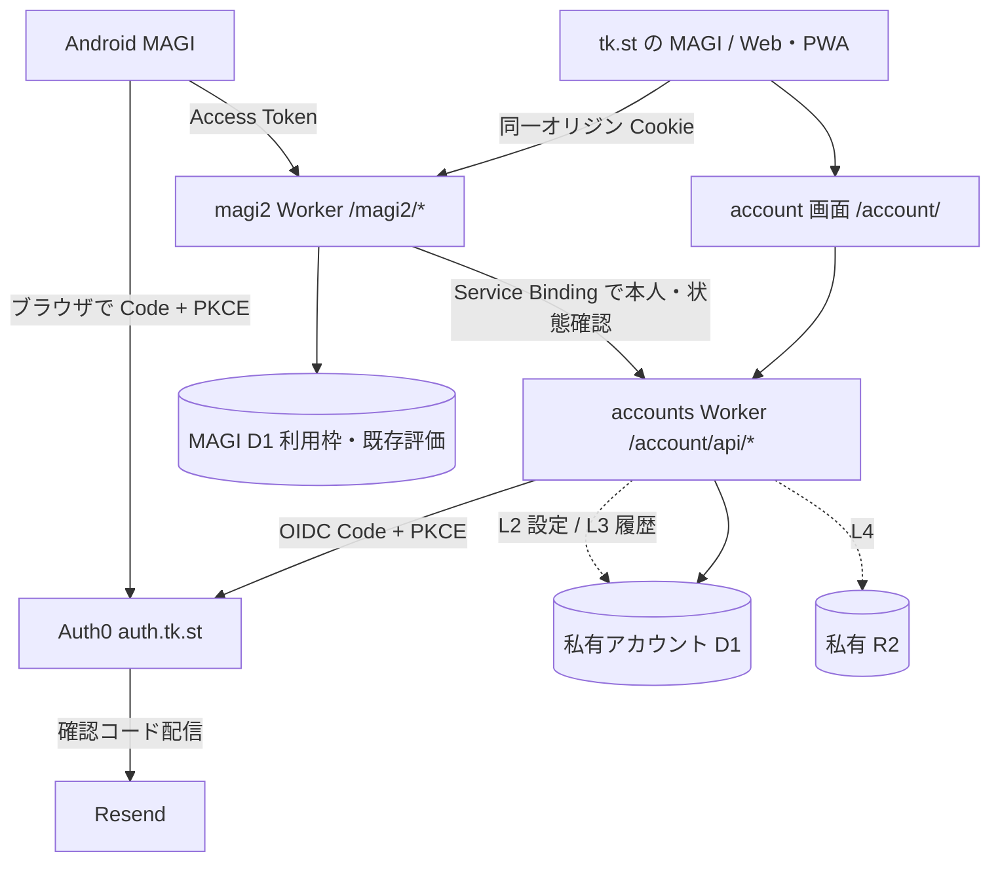

# tk.st / MAGI ログイン設計書

設計案（2026-10-25）。未実装・未公開。本人指定は Auth0 採用・アプリ間 SSO なし。任意ログイン、利用枠、同期範囲、保持期間は本書の提案。
実装・公開後は冒頭を「実装済み（日付）。正本はコード」に変更し、以後は更新しない。

対象はトップページの MAGI、Web/PWA、Android、magi2 Worker と新設アカウント基盤。[検証計画書](magi2ログイン検証計画.md) と、一時チャット・パーソナライズの既存仕様を併用する。

## 1. 目的・指定事項・対象外

| ID | 区分 | 要件・方針 |
| --- | --- | --- |
| R01 | 本人指定 | 認証は Auth0。自作の Magic Link / WebAuthn サーバーは作らない |
| R02 | 本人指定 | アプリ間 SSO は省く。Web と Android は別クライアント・別セッションでログインする |
| R03 | 設計提案 | ログインは任意。公開ページ・SAFE TOOLS・検索の利用に登録を要求しない |
| R04 | 設計提案 | メール確認コード（Resend 配信）とパスキーを同一 Auth0 プロフィールで使う |
| R05 | 設計提案 | 本人の認証、アプリ内の所有者判定、利用制限を別の責務にする |
| R06 | 設計提案 | アカウント利用枠と、IP・全体の費用上限を併用する |
| R07 | 設計提案 | ログイン・設定同期・履歴同期の同意を分ける。既存履歴を自動送信しない |
| R08 | 維持する制約 | 一時チャットは永続保存・同期しない。パーソナライズも適用しない |
| R09 | 設計提案 | アカウント切替・ログアウトで履歴、受信、保留データ、同期キューを混ぜない |
| R10 | 設計提案 | 旧画面・旧 APK はゲストとして継続。認証専用 API に旧 Origin/API キーの抜け道を作らない |
| R11 | 設計提案 | アカウント削除・書き出し・同期停止を提供し、削除の完了範囲を表示する |
| R12 | 維持する制約 | トップの外部アセット制限、tools の通信制限、静的 HTML の構成を守る |
| R13 | 設計提案 | 認証情報・会話・個人設定を URL、アクセス解析、公開データ、診断ログに混入させない |
| R14 | 設計提案 | Worker 先行で段階公開し、停止時も既存の端末履歴と削除処理を保全する |

目的は利用枠の公平性、設定・履歴の引継ぎと復元、個別の利用停止。同期には別途実装が必要で、ログインだけでは保存データの暗号化や不正利用の完全防止は実現しない。管理者権限、課金、ゲーム・DJ 管理画面への展開は対象外。

## 2. 現状

2026-10-25 の作業ツリーを参照。公開済みかどうかは公開記録で照合する。変更対象は4.1、保存説明は第13章にまとめる。

| 項目 | 現状 |
| --- | --- |
| 履歴・設定 | トップ/Web/PWA は localStorage、Android は `native-history.js` 経由のファイル。利用者別の分離・端末間同期なし |
| Android 受信 | `native-background.js` と Conversation Plugin/Service/StreamStore が固定 URL の SSE を受け、途中データを保存・復旧 |
| Worker・DB | Origin/API キーで入口を許可し、IP・全体で回数を管理。`rate_limit`、`reactions`、`search_clicks` があり、評価しない通常本文は DB に保存しない |
| 通信・キャッシュ | Worker route は `workers.tk.st/magi2*` と `tk.st/search/api/*`。PWA はアプリ資産をキャッシュ。同一オリジンの個人 API は未実装 |

## 3. 段階・公開条件

| 段階 | 実装範囲 | 公開時に保存するもの |
| --- | --- | --- |
| L0 | Auth0 Free・メール OTP・パスキー・SSO 抑止・Android 復帰の成立性確認 | 合成アカウントと試験結果のみ |
| L1 | 任意ログイン、パスキー、利用枠、利用者別端末保存、ログアウト、退会 | 内部 ID・認証セッション・利用枠・削除ジョブ。通常本文は端末だけ |
| L2 | 任意の設定同期・設定書き出し | 同意した呼び方・カスタム指示。初回公開を L1+L2 とする提案 |
| L3 | 任意の通常履歴同期、明示取込み、競合・削除の伝播 | 同意した会話。添付対応までは添付付き会話の同期を提供しない |
| L4 | 画像・共有資料を含む同期 | 私有 R2 オブジェクトと所有者付きメタデータ |

L3/L4 は後続段階とし、公開条件を L1/L2 と分ける。UI は公開済みの機能だけを案内する。

## 4. 構成・責務

- Auth0 はメール本人確認・パスキー・復旧・トークン発行。会話本文やカスタム指示を Auth0 の metadata に置かない。
- 新設 `workers/accounts/` は本人確認の検証、内部 ID、Web セッション、同期 API、削除ジョブを所有する。Auth0 への照会をチャットごとに行わない。
- magi2 は accounts の内部 `resolvePrincipal` に Cookie または Bearer を渡し、`userId / status / authKind` を得る。公開経路からの `X-User-ID` 等は信頼しない。内部 RPC は Service Binding だけで呼べるようにする。
- アカウント D1 は本番・評価で分離し、magi2 の既存 DB は維持する。実 ID・トークン・履歴は私有 DB に置く。

### 4.1 作成・変更するファイル（実装予定）

| 置き場所 | 担当 |
| --- | --- |
| `account/index.html`、`account/account.js`、`account/account.css` | アカウント画面。日英・ライト/ダーク・キーボード操作 |
| `workers/accounts/src/index.js`、同区画内の `identity.js`、`sessions.js`、`settings.js`、`deletion.js` | OIDC/トークン検証、Web セッション、所有者確認、データ管理 |
| `workers/accounts/schema.sql`、`migrations/`、`wrangler.toml`、`README.md` | 私有 DB、Service Binding、運用・鍵の更新 |
| `workers/magi2/auth.js`、`quota.js`、`src/index.js`、`migrations/` | 共通 principal、利用枠、全 API の入口 |
| `index.html`、`magi-app/www/app.js`、`native-history.js`、`native-background.js`、`sw.js` | `/account/` 導線・セッション確認、利用者別の保存・通信・キャッシュ除外 |
| `workers/magi2/personas.js` の `PRIVACY` とアプリの保存説明 | 公開段階・同意状態に合う説明 |
| Android の認証プラグイン、Manifest、Conversation Plugin/Service/StreamStore | Code + PKCE、App Links、Keystore、ネイティブ受信 |
| `.github/scripts/` の検証、deploy-worker の入口・共通処理 | 模擬試験、accounts の選択肢と deploy 対応 |

既存の静的構成・ライブラリ取り込み規則を守り、トップに外部 JS/CSS を追加しない。JWT/OIDC の暗号検証には保守されているライブラリを使い、版・Wrangler/Node 24 互換・ライセンスを L0 で固定する。

## 5. Auth0 設定と SSO を使わない契約

1. Free テナント、独自ドメイン `auth.tk.st`、Web 用 Regular Web Application、Android 用 Native Application、MAGI 用 API audience を用意する。名称は予定値。評価設定は本番から隔離し、Free のテナント制限を確認する。
2. 1つの Database Connection に email OTP と passkey を設定し、Identifier First / New Universal Login を使う。別の legacy passwordless connection やソーシャルログインは初期導入しない。Account Linking への依存を作らない。
3. Resend をメールプロバイダーに設定し、認証用途の送信権限・到達・再送制限を確認する。鍵は Auth0 側に設定する。
4. パスキー RP ID は原則 `auth.tk.st`。Web/Android とも初期は同じ Universal Login 上で登録・認証する。直接 tk.st の DOM で WebAuthn を呼ぶ方式や Android の Native Passkey API は初期対象外。
5. Web と Android は別 client ID・redirect URI・セッション・refresh token を使う。対話ログインで `prompt=login` と `max_age=0` を指定し、`auth_time` と開始時刻（許容ずれ込み）を照合する。iframe silent SSO・Native-to-Web transfer は使わず、各アプリ自身の refresh token 更新は継続する。

Web/PWA は同じ Web アプリの入口とするが、ブラウザ・standalone PWA ごとの Cookie 分離を考慮する。パスキーが同期されても、別端末の初回認証は必要。

### 5.1 Web/PWA のログイン

- `/account/api/login` は CSRF 対策した POST。許可済みの戻り先パスと OIDC transaction を作り、認証先 URL を返す。
- accounts が `state / nonce / code_verifier / started_at / return_path` を5分だけ保持。ブラウザには照合用の短期 HttpOnly Cookie を渡し、state とブラウザの両方に結び付ける。複数タブは transaction ごとに区別する。
- callback は accounts Worker の `/account/api/callback`。code・state を一度だけ受け、PKCE、署名、issuer、Web client audience、nonce、時刻、認証方式/メール確認を検査する。失敗時はセッションを作らない。
- 成功時は新しいランダムなセッションを作り、`__Host-st_session`（Secure、HttpOnly、SameSite=Lax、Path=/、Domain なし）を `tk.st` に設定。固定化を防ぎ旧 ID は廃棄する。
- Auth0 トークンはサーバー側に置き、refresh token は Wrangler secret の鍵で暗号化。D1 にはセッション秘密のハッシュだけを保存。暗号鍵には版を持たせる。
- callback は本文・外部アセットを出さず、クエリのない許可済みパスへ303。計測・キャッシュ制御は第13章に従う。
- Web の JS/localStorage/IndexedDB に長期認証トークンを置かない。Cookie 付きの更新・削除・同期・チャット送信に厳密な Origin と CSRF トークンを要求する。Cookie なしの悪意あるサイトからログイン transaction を作成させない。

### 5.2 Android のログイン・受信

- システムブラウザを使う Authorization Code + PKCE（S256）。認証 WebView を自作しない。Native client に client secret を埋め込まない。
- callback は検証済み HTTPS App Link を優先し、専用の `tk.st/account/native/callback` に限定する。Android package と配布署名 SHA-256 を `/.well-known/assetlinks.json` に設定し、初期版で App Link が成立しなければ公開を止める。既存の内部用 `magi://` を公開 intent-filter に変更しない。
- Native callback は accounts Worker の専用 route とし、アプリが開かれない場合は code/state を表示・転送しない中止案内を返す。計測・キャッシュ制御は第13章に従う。
- Native 側で state/nonce/verifier を照合し code を交換。キャンセル、別 Activity/アプリによる横取り、プロセス再作成、二重 callback は transaction ごとに拒否する。トークンや code を起動 URL の転送パラメーターに載せない。
- refresh token は Keystore で保護するネイティブ保存先。更新・ローテーションは1つの管理器に集約し、WebView とバックグラウンド Service の同時更新を直列化する。access token は必要時だけメモリで渡す。
- 通常 SSE の `MagiConversationService` にも Authorization を付ける。journal/pending/通知/エクスポートにトークンを保存せず、保留回収は第9章の所有者・世代の照合に従う。
- 再認証が必要なら送信前に知らせる。401 後に同じ AI 要求を自動再送しない。期限切れ前の認証更新と、送信済み本文の再実行を分ける。
- Android の一時チャットは WebView 内の SSE にメモリ上の access token を付ける。Native pending への保存、長期 token の WebView 保存、WebSocket への暗黙切替は行わない。

### 5.3 期間と失効（提案値）

access token は5分、Web セッションは絶対7日・無操作24時間、refresh token は絶対30日・無操作7日を上限とし、Free の設定可能範囲を L0 で検証する。画面の活動だけでトークンを頻繁に更新しない。

Web ログアウトはローカルの受信・キューを停止し、サーバーセッションを失効、Cookie とサーバーの refresh token を破棄/失効する。Android は送信・同期を停止し、Keystore 内の資格情報を破棄、refresh token の失効を試みる。ネット切断中も画面は即座にログアウトし、サーバー側処理の未完了は再接続後に扱う。

オフラインでは Web の HttpOnly Cookie を消せないため、秘密を含まない「ログアウト処理待ち」フラグを端末に保存する。再起動・別タブでも logout API の成功までアカウント復元・通信・guest送信を止める。Native の遠隔失効通信が失敗した場合も、ローカル token 消去と遠隔失効の結果を区別する。

Android の流出済み access token はログアウト後も最大5分＋検証許容ずれ残る。アプリの利用停止・退会は D1 の status を要求ごとに確認し、新規アクセスを拒否する。Auth0 側だけのブロックによる既発行 token の即時失効、全端末一括ログアウトは初期仕様に含めない。

### 5.4 パスキーの一覧・取消（L1）

`/account/` に登録済みパスキーの一覧と取消を設ける。登録は第5章の Universal Login を使い、管理には Auth0 My Account API を別に有効化する。Free での利用権と必要な API が成立することを G01 の公開条件に含める。

- 管理用の対話認証は `purpose=passkey_manage`、現在の user/issuer/sub、nonce に結び付ける。Auth0 の audience は `https://auth.tk.st/me/`、scope は `read:me:authentication_methods` と `delete:me:authentication_methods` に限定する。MAGI API token や M2M token では代用しない。
- 管理用 callback は既存アカウントとの issuer/sub 一致と5分以内の auth_time をサーバーで検査し、別人の認証では403にする。管理 token は短期・サーバー内に保持し、通常セッションと分離する。client grant はこの Web client だけに限定し、allow_all を使わない。
- 一覧は本人の `type=passkey` の ID・表示名・利用可能な作成日時等だけ。取消は確認画面、CSRF、一回 intent、対象 ID が本人の passkey であることを再照合して Auth0 の削除 API を呼ぶ。メール等の別認証方式の ID は削除できない。
- 最後のキーを消すときは確認済みメールによる復旧経路を確認し、復旧手段がない場合は拒否する。成功後は再取得して対象キーの削除を確認し、パスワードマネージャー側に残る表示と、既発行 token の残存時間を案内する。
- Android からも同じ専用 Web 画面を開き、Web として対話ログインする。Native token やセッションを移送せず、対象アカウントを画面に明示する。

## 6. 本人・権限・API の境界

内部 user ID はランダム UUID、Auth0 との対応は正規化した issuer と sub の一意制約で保持する。メール一致で統合しない。メールは Auth0 で管理し、D1 に重複保存しない。登録時の email_verified は信頼する issuer の情報で確認する。

Native の初期登録は `/account/api/native/bootstrap` に有効な API access token を送り、issuer の `/userinfo` で sub と確認済みメールを照合した後だけ内部 ID を作る。この token の audience/scope で `/userinfo` が成立することを L0 の必須条件とする。Web callback/Native bootstrap は、新しい内部 ID の write_epoch と MAGI D1 の active gate の初期化まで確認して登録を完了する。途中失敗は冪等に再開し、閉鎖済み gate を古い初期化 RPC で再開しない。以後の API に user/gate 自動作成の副作用を持たせない。

Native access token は固定 issuer、API audience、許可アルゴリズム、exp/nbf、必要 scope、許可 Native client（azp 等、採用形式で定義）を検証する。ID token を API の認証として受け付けない。JWKS は固定の issuer から期限付きでキャッシュし、未知 kid 時の再取得を制限する。token 内の URL を取得先に使わない。Auth0 停止時は既知鍵で期限内 token の検証のみ継続し、新しい鍵・更新・ログインの失敗を認証成功とみなさない。

| 入口 | 認証・扱い |
| --- | --- |
| `tk.st/account/api/*` | accounts Worker。Web Cookie と CSRF、または許可 Native Bearer。公開 callback だけ OIDC transaction で検証 |
| `tk.st/account/native/callback` | accounts Worker の専用 route。App Link 不成立時の安全な中止案内だけ |
| `tk.st/magi2/*` | 新 Web/PWA 用。同一オリジン Cookie。magi2 が accounts で所有者を解決 |
| `workers.tk.st/magi2*` | 旧クライアントのゲスト経路を維持。新 Android の Bearer も検証し同じアカウント枠へ |
| `/magi2/models`、`/versions` | 公開情報。個人セッション・メール・内部 ID を混ぜない |
| `/magi2/usage` | principal と同じ利用枠を返す。認証なしは従来形式のゲスト枠、追加項目は後方互換 |
| `/chat`、`/speech`、`/react`、不具合報告 | 各既存条件に本人確認を加える。ログインを理由に本文の保存・評価を自動化しない |
| `/search/api/*`、404、DJ、旧 MAGI | 今回はゲストのまま。Cookie が届いても勝手に利用者と結び付けない |

Cookie と Bearer の同時指定、クライアント指定の owner は拒否する。認証専用 API は Origin/CLIENT_API_KEY だけでは通さず、SQL の WHERE にサーバー決定の user_id を含める。

不正/期限切れ認証は401、accounts 障害は503。認証付き要求はゲストへ自動降格せず、無認証 guest は独立した既存経路を使う。

新しい MAGI 要求には `X-ST-Auth-Mode: account | guest` を付ける。account 指定で期限切れ等により資格情報が消えていた場合も401にし、guestとして実行しない。guest 指定と有効なアカウント資格情報が衝突する要求は拒否し、明示ログアウトへ案内する。旧画面の指定なしは旧ゲスト契約として扱うが、届いた不正認証を無視しない。WS は最初のフレームで同じモードを宣言する。Cookie 認証は `tk.st` の新入口だけで受け、`workers.tk.st` では Native Bearer または従来ゲストだけを受ける。CORS は対象入口の必要メソッドと Authorization/CSRF/Auth-Mode だけを追加し、既存の任意 Origin 許可を広げない。

### 6.1 SSE / WebSocket / 音声

SSE は送信前に principal と利用枠を確定する。WebSocket はブラウザから Authorization ヘッダーを任意に付けられないため、認証付き POST `/account/api/stream-ticket` で30秒・一回限りの ticket を発行する。ticket はセッション・user・用途・要求 nonce に結び付け、最初のフレームで渡す。URL・subprotocol・ログには載せない。

WS は Origin を厳密照合し、account モードの ticket 欠落/不正はエラーで閉じる。ticket 消費は原子的に行い、セッションの失効・status を再確認する。最初のフレームはサイズ・到着期限を制限し、認証前に AI を呼ばない。

開始後の token 期限切れだけなら既存の最大受信時間内でその1回答を完了でき、新しい要求は認証を更新する。Web セッション失効・アカウント停止は最長30秒ごとの確認で受信を停止する。端末のログアウトは即座に通信を停止する。既に送った上流への要求や課金を取り消せる保証はしない。

新しい音声署名は user/guest と用途・期限を結び付け、別利用者の署名で利用枠を消費できないようにする。旧署名はゲスト互換に限定する。一時音声は既存どおりキャッシュしない。個人設定/同期内容を反映した通常音声のキャッシュは利用者別とし、削除対象キーの索引と短期 TTL を持たせる。署名付き回答の同期から再生する場合も現在の本人確認と期限を検査する。

## 7. 利用枠

| 種別 | 提案 |
| --- | --- |
| 通常チャット | L1 ではゲストの現行 IP 枠を維持。ログインは user 単位で現行 `DEFAULTS.daily_limit` と同じ値を初期値にする |
| Web 検索・音声 | user ごとの上限を既存 IP 上限から開始。feature 別の回数・サイト全体上限を維持 |
| 短時間大量送信 | 認証の有無と独立した IP の安全弁。通常の共有回線利用を圧迫しない別枠として負荷試験で確定 |
| 旧画面・旧 APK | ゲスト枠。ログインの枠へ加算しない |
| 集計日 | 現行どおり UTC。画面には現地時刻でリセット日時を表示 |

枠の縮小・拡大は後続変更とする。ログアウト後の guest 枠や複数アカウントによる利用は全体・IP 制限で抑える。

入力/認証/機能の検査 → 既存 QA 予算ガード → principal・IP・global の予約 → AI の順。予約は MAGI D1 で原子的に行い、いずれかが上限なら全予約をロールバックする。上限違反時に SQL エラーを発生させる trigger 等を使い、batch の成功を上限検査の成功と混同しない。

個人枠は user と guest IP で分けるが、全体枠は次の既存 `rate_limit` の行を新旧すべての入口で共有する。新 quota に別の global を作らず、user quota・IP安全弁・既存 global 行を同じ D1 の予約単位に含める。

| 機能 | 共通の全体カウンター（UTC日単位） |
| --- | --- |
| 通常チャット・404の続きなど現行チャット枠の利用 | `rate_limit` の `global` |
| 回答中のWeb検索 | `rate_limit` の `research:global` |
| 読み上げ | `rate_limit` の `speech:global` |

旧 Web・旧 APK・APIキー・guest・新Web Cookie・Android Bearer は同じ予約処理を通す。旧クライアントの応答形式と上限値は維持し、バックエンドの予約処理だけを統一する。新旧の個人枠を二重計上しない。検索初回・rank・描画などの既存の機能別全体カウンターは今回統合せず、それぞれの既存キーを維持する。切替前に全対象経路を接続し、一部だけ別の全体カウンターへ切り替える公開は行わない。

要求 nonce の一意制約で WS→SSE 切替・二重送信の重複実行を拒否する。受理済み nonce の再送は409で、本文の再実行や回答キャッシュは行わない。予約後の上流失敗・停止は消費する。`usage` の参照、認証失敗、利用枠不足、ticket だけの発行では AI 枠を消費しない。

自動 transport 切替は同一送信の5分以内に限る。再起動後の pending は受信結果の回収だけで、AI を再実行しない。予約の8日保持を超えた同 nonce はサーバーで再識別できないため、自動再送を禁止し、利用者が明示的に再試行する場合だけ新しい nonce を作る。

## 8. データと保持（提案値）

### 8.1 私有 DB の概念スキーマ

| 表 | 主な項目・制約 |
| --- | --- |
| users | id、status（active/blocked/deleting/deleted）、write_epoch、created_at、deleted_at。メールを主キーにしない |
| identities | issuer、sub、user_id。issuer+sub が一意。退会中の再作成防止も担当 |
| web_sessions | secret_hash、user_id、期限、最終利用、暗号化 refresh token、鍵版、失効日時。更新の直列化用 lease/version |
| login_transactions | transaction_hash、nonce/verifier の保護値、ブラウザ結び付け、期限、消費状態 |
| stream_tickets | ticket_hash、session/user、用途、要求 nonce、期限、消費日時 |
| preferences / sync_consents | user_id、revision、呼び方・指示、種別ごとの同意・同意版・日時 |
| deletion_jobs | user_id、対象と進捗、再試行回数、次回日時。メール/本文/生トークンを記録しない |
| write_leases（L4） | user_id、write_epoch、操作ID、対象object_key、期限、終了状態。DB外への書込みの追跡 |
| conversations（L3） | user_id+id、revision、title、本文 JSON、mode、削除状態、更新順 cursor |
| attachments（L4） | user_id、会話 ID、私有 object_key、サイズ、種別、削除状態 |

MAGI DB 側には user/guest の quota、nonce 予約、`account_write_gates(user_id, write_epoch, state)` を追加する。全体枠は第7章の既存行を使う。migration は実装時の次番号を使う。

### 8.2 保持・削除

- login transaction/ticket は第5章・6.1の期限で失効後、24時間以内に掃除する。セッションの秘密・暗号化 token は失効処理で除去する。
- 新設の利用枠・要求 nonce は8日以内で掃除する。IP は用途・日付・secret の salt を使った HMAC を用い、認証ログに実 IP を増やさない。既存検索クリックの90日運用は今回の対象外。
- 同期設定・会話は有効なアカウントの間保持し、容量枠を設ける。提案初期値は設定1件、本文会話100件・合計10MiB/人。超過で既存データを自動削除せず書込みを拒否する。L3 前に D1 全体容量と費用も確認する。
- 明示削除した本文・R2 実体は24時間以内に現行ストアから除去する。同期用 tombstone は30日保持し、それより古い cursor は全再同期を要求して古い端末からの復活を防ぐ。
- D1 Time Travel/バックアップ、Auth0/Resend の保持期間は別途確認し、第12章の再削除手順とともに説明する。24時間の削除期限はバックアップに適用しない。

## 9. 端末保存・切替

保存空間は `guest` と内部 user ID ごとに分離する。既存の `magi_saved_sessions`、現在履歴、個人設定、Android `magi/` は guest として保全し、ログインだけで所有者を変えない。

各処理は開始時の `owner / auth_generation / conversation_id / revision` を描画・保存・同期・通知・保留回収の直前に再照合する。切替は世代更新 → AI受信・再生・添付・同期の停止 → 画面ロック → 次領域を開く順。ログイン前の未送信文は guest に保持し、callback に載せない。

ログアウトで当該アカウントの端末キャッシュと pending を消すのを初期方針とする。未同期の会話がある場合は、破棄・書き出し・操作中止を選べる。書き出し先に内容が残ることを示す。ログイン切れでは即削除せず、対象領域をロックし同じアカウントの再認証で回復する。guest の既存履歴はどちらの場合も消さない。

アカウント別領域は偶発的な混入を防ぐもので、同一端末の管理者や XSS からの暗号学的な隔離ではない。端末・OS のロックとデータ書き出し時の注意も説明する。

## 10. 設定同期（L2）

初期はオフ。同意後に、端末値を送るか既存のサーバー値を使うか表示する。呼び方50文字・指示2,000文字など現行の上限を維持し、UI テーマ・言語のような端末向け設定は初期対象外とする。

更新は base revision 付きで行い、競合は409と両候補を表示する。端末時刻で上書きせず、オフラインキューにも owner と元 revision を保持する。適用・再送時は R08 と第9章の条件を照合する。

「同期を停止」はアカウント全体の consent revision を進め、古い端末の同期要求を拒否する。保存済み設定を消す操作は別に用意する。同期停止で本来端末だけに保持する設定まで勝手に公開・削除しない。

## 11. 履歴・添付同期（L3/L4、後続）

- 同意は設定同期と別。新しい通常会話から対象にし、既存会話は一覧・件数・対象を示す明示取込み。guest データは取込み成功の読み戻し前に削除しない。
- 会話オブジェクトの `mode` を保存入口と API の両方で検査し、temporary はタイトル・画像・本文ハッシュを含め永続化しない。クライアント自己申告の限界は既存設計と同じで、偽装 normal まで検出できるとは言わない。
- L3 は添付のない会話だけ。画像/共有資料/途中受信の付いた会話は黙って欠落させず、未対応として一覧に示す。L4 は添付を含む完全復元を検証してから開く。
- 会話単位の revision と server cursor を使い、並行更新は409。削除済み ID への遅延更新は拒否し、オフライン端末が削除済み会話を復活させない。
- R2 は私有 bucket とし、ダウンロード API が owner と拡張子・型・サイズを検査する。object_key だけで取得できる公開 URL は作らない。
- 同期状態を「端末のみ/同期待ち/同期済み/競合/失敗」で表示。送信成功と同期成功を分け、失敗時も端末の原本と書き出しを維持する。

## 12. アカウント API と削除

| 予定 API（`/account/api` 以下） | 契約 |
| --- | --- |
| `GET /session` | guest/authenticated、最小の表示情報・機能・CSRF token。user 作成なし |
| `POST /login`、`GET /callback` | 第5章の Web OIDC transaction |
| `POST /native/bootstrap` | 第6章の Native 初期登録 |
| `POST /logout` | 5.3の Web セッション失効 |
| `POST /stream-ticket` | 6.1の Web ストリーム認証 |
| `POST /passkeys/authorize`、`GET /passkeys/callback` | 5.4の管理用対話認証。既存本人との一致が必須 |
| `GET /passkeys`、`POST /passkeys/revocation-intent`、`POST /passkeys/revoke` | 5.4の本人のキー一覧・一回取消。新鮮な管理認証とCSRFが必須 |
| `GET/PUT /preferences`（L2） | 本人のみ。PUT は同意版と base revision 必須 |
| `PUT /sync-consents`（L2/L3） | 種別ごとの明示同意/停止と consent revision |
| `GET/PUT/DELETE /conversations` 等（L3） | 所有者・同意・revision・削除状態・容量を検査 |
| `POST /export` | 当該段階で保存する本人データの認証付き書き出し |
| `POST /deletion-intent`、`POST /delete` | 新鮮な認証に結び付いた一回 intent と CSRF。単純な GET で削除しない |

`/delete` は5分以内の対話認証を条件とする。Native は新しい Code+PKCE ログインの ID token の署名・Native audience・nonce/intent・auth_time をサーバーで照合し、通常 API の認証とは区別する。Web もサーバー側で auth_time を照合する。意図の検証をブラウザだけに任せない。

### 12.1 退会と並行する書込み

要求冒頭の本人確認だけでは書込みを許可しない。accounts D1 内の個人データ更新は、捕捉した write_epoch と `users.status=active` の検査を更新と同じ SQL トランザクションで行う。MAGI D1 の owner 付き評価・音声キャッシュ索引等も、同 DB の account_write_gates が active かつ epoch 一致の場合だけ更新できるようにする。条件不一致は処理全体をロールバックし、ゲスト書込みへ逃がさない。

退会ジョブは次の順に冪等に進める。

1. accounts D1 で users を deleting にし write_epoch を増やす。セッションを失効し、新しい同期・受信・書込み許可を止める。
2. Service Binding で MAGI D1 の gate を閉じ、閉鎖の commit を確認する。古い epoch の要求や再試行で再開できないよう、epoch は単調増加にする。片方の DB が使えない間は処理中とし、削除完了へ進まない。
3. 進行中ストリームを停止する。両 DB の gate より先に commit した書込みは後続の削除対象に含め、gate より後の書込みは SQL 側で拒否する。
4. L4 の R2 書込みは、accounts D1 で active/epoch を照合して取得した write lease を必須とする。退会では新規 lease を止め、発行済み I/O の終了を確認してから object を削除する。中断・期限切れだけで成功/終了とみなさず、結果不明の操作は再照合する。未解決 I/O がある間は完了にしない。
5. 本文・設定・添付・owner付き評価とキャッシュ索引を削除し、両 DB と対象オブジェクトを最終照合する。残存/孤立オブジェクトや遅延書込みがあれば再削除し、書込み停止と残存0の両方を確認して完了にする。キャッシュ音声は削除処理と最大24時間のTTLで回収する。

Auth0 user の削除も同じジョブで行う。Management API は最小権限とし、M2M token を期限まで再利用する。owner のない旧評価を IP/本文から本人へ割り当てず、既存 delete_token の取消手段を維持する。L4 は、クラッシュした書込みと R2 の結果不明状態を含む終了確認を実証してから公開する。

外部サービス障害で削除が残ったら「受付済み/処理中」と未完了箇所を表示する。identity の拒否記録は Auth0 削除・全 refresh token 失効の確認後、既発行 access token の最大期限＋余裕が過ぎるまで保持し、古い token/bootstrap からの復活を防ぐ。バックアップ復元時は削除台帳を再適用してから再開する。

## 13. 説明・キャッシュ・計測

`System & Privacy`、アプリの保存説明、account 画面を公開段階に合わせる。L2/L3 の同意は別とし、ログインだけで通常本文をサーバー保存しない。メール等は認証で Auth0、配信で Resend に渡り、同期データは Cloudflare に保存する。会話・内部 user ID を AI や検索計測へ追加送信しない。一時チャットにも user/day カウンターが残ることを説明する。

account と Web/Native callback は解析タグなし・`Referrer-Policy: no-referrer`。code/state を含む callback クエリはアプリ解析へ送らず、エッジログの扱いも確認する。全 API と認証ページ・書き出しは `Cache-Control: no-store`。PWA は `/account/` と個人化した `/magi2/*` を Network Only とし、CDN/Cache API/SW で個人応答を共有しない。

### 13.1 旧 Service Worker からの移行

現行 SW は `/magi2/` 以外の同一オリジン GET を広く Cache API に保存し、HTTP の no-store だけでは阻止できない。PWA から最初の `/account/api/session`、login、設定取得を呼ぶ前に、次の移行を完了する。

1. 新 SW はキャッシュを app shell の明示 allowlist に限定し、`/account/` 配下と個人 API を常に Network Only にする。個人 URL で既存キャッシュを検索しない。
2. ページは SW 更新を要求し、現在の controller との nonce 付き MessageChannel 応答で認証対応の cache_policy_version を確認する。`ready` やサーバーの機能応答だけで判定せず、必要なら controllerchange を待つ。
3. 新 SW は MAGI の旧キャッシュと既存の個人 URL エントリーを除去してから準備完了を返す。他区画のキャッシュは消さない。旧 SW の遅延 put が残っても、新ポリシーでは個人 URL をキャッシュから配信しない。
4. 応答なし・旧版・更新失敗中は個人 API を一切呼ばず、更新案内を出す。旧画面の無認証利用は従来の別オリジン API のまま維持する。ログイン停止フラグの解除と SW 更新を同時に済んだものと扱わない。

SW に制御されない通常ページはこの待機を要しない。キャッシュ更新済みの別タブがあっても、各 controlled client 自身が上記を確認する。

本文・指示・メール・token・code・生の認証 URL は診断ログ/通知に出さず、GTM user_id にも設定しない。診断用 user 識別は別 salt の短期仮名にする。私有データを公開リポジトリの `data/` に置かない。

`www.tk.st` はログイン開始前に正規の `tk.st` へ移す。host-only Cookie を全サブドメインへ広げない。トップの tk.st 以外で動く版は account API を読まず、既存ゲスト表示を維持する。SAFE TOOLS の CSP・通信先・解析設定を拡張しない。

## 14. 公開・運用・停止

1. 第15章の L0 ゲートを満たす。実施結果と設定値は検証計画の様式で記録する。
2. accounts の DB/鍵/Worker、Service Binding、同一オリジン route を先に設定。deploy-worker の入口と共通 workflow に新 Worker を追加し、dry-run で本番依存を確認する。MAGI D1 の書込みgateと全体枠の共通予約も接続する。
3. magi2 の新認証・利用枠を機能フラグ off で公開し、認証対応 SW を先行配信する。旧クライアント・guest・検索・DJ の回帰と13.1の移行を確かめる。既存の Anthropic 鍵同期と deployment message 手順を維持する。
4. Web/PWA と Android を順に公開する。版は既存規則に従い、APP_VERSION/表示/package/Android/履歴をそろえる。
5. L1 合格後にログイン機能、L2 合格後に設定同期を有効化。L3/L4 は別の合格表と保存説明の公開後にだけ有効化する。

新規ログイン、accountチャット、設定同期、履歴同期の停止フラグを分ける。停止中も logout/export/delete と必要な認証更新を維持し、guest利用は明示ログアウト後に限る。認証失敗は第6章、オフラインの扱いは5.3に従う。ロールバックでデータや migration を自動削除しない。

監視は成功/拒否/期限切れ/更新失敗/利用枠拒否/競合/削除滞留の件数と遅延。費用は Auth0 MAU/M2M、Workers/D1/R2、Resend を分けて観測する。

## 15. 実装開始・公開前に確定する事項

| ID | 未確定・確認事項 | 関連段階 |
| --- | --- | --- |
| G01 | trial 終了後の Free で同一 DB の email OTP、progressive passkey enrollment、独自ドメイン、再認証設定、My Account APIの本人キー一覧/取消が利用できるか | L0→L1 必須 |
| G02 | Free の期限設定、Native audience/userinfo、refresh rotation、Web の更新 lease と障害復旧 | L0→L1 必須 |
| G03 | Android 署名済み App Links、採用 SDK/ライブラリと Capacitor 8 互換、複数 callback/復帰 | L0→Android 公開必須 |
| G04 | 認証・データ鍵の保存/更新、Private DBとバックアップの保持、DB間の書込み停止・最終削除、M2M無料枠、新旧全体枠の共通予約、旧SW移行 | L1 必須 |
| G05 | 任意ログイン、初期枠・期限・キャッシュ破棄、同期同意と保持値の最終採用 | L1/L2 の公開前 |
| G06 | 添付・競合・容量・tombstone・バックアップ再削除、R2の書込みleaseと結果不明I/Oの終了確認、公開文言 | L3/L4 の公開前 |

未達項目がある段階は公開しない。

### 15.1 レビュー指摘への対応

対象は本書と検証計画を含む同一コミットの文書。fixed は設計修正の状態であり、実装試験は未実施。

| 指摘ID | 状態 | 設計の根拠 | 追加する検証 |
| --- | --- | --- | --- |
| LOGIN-01：旧SWの個人APIキャッシュ | fixed | 13.1、先行SW公開とcontroller確認 | V-07/V-08 |
| LOGIN-02：退会と並行する書込み | fixed | 12.1、各DBの書込みgate・epochと最終照合 | D-06〜D-08、H-10 |
| LOGIN-03：新旧全体枠の分断 | fixed | 第7章、既存global行の共通予約 | Q-06/Q-07 |
| LOGIN-04：パスキー取消の管理経路 | fixed | 5.4、第12章の管理API、G01 | F-07、P-05〜P-07 |

## 16. 参照（2026-10-25 確認）

- [Auth0 料金](https://auth0.com/pricing)：Free のパスキー・独自ドメインと、Cross APP SSO 対象外。契約時に再確認する。
- [DB Connection の Passwordless](https://auth0.com/docs/authenticate/database-connections/passwordless-authentication-for-db-connect)：同一 DB での OTP とパスキー登録。
- [パスキー](https://auth0.com/docs/authenticate/database-connections/passkeys)：RP ID、登録と対応条件。
- [My Account API](https://auth0.com/docs/manage-users/my-account-api)：本人による認証方式の一覧・削除、audienceとscope。
- [Code + PKCE](https://auth0.com/docs/get-started/authentication-and-authorization-flow/authorization-code-flow-with-pkce)：公開 Native client の認証。
- [アクセストークン検証](https://auth0.com/docs/secure/tokens/access-tokens/validate-access-tokens)、[再認証](https://auth0.com/docs/authenticate/login/max-age-reauthentication)、[refresh rotation](https://auth0.com/docs/secure/tokens/refresh-tokens/refresh-token-rotation)。
- [メール配信](https://auth0.com/docs/customize/email/smtp-email-providers)：Resend 連携と本番配信。
- [D1 Database API](https://developers.cloudflare.com/d1/worker-api/d1-database/)：batch のトランザクションと失敗時ロールバック。
- [Cache API](https://developer.mozilla.org/en-US/docs/Web/API/Cache)：HTTPキャッシュヘッダーだけでは制御できないことと明示削除。

利用権・実機動作の確認結果は検証計画に沿って記録する。
