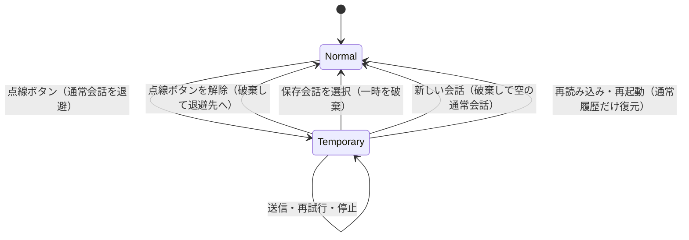

# magi2 一時チャット・パーソナライズ設計書

設計案（2026-10-24）。未実装。確定事項と残る設計案は第2章に記載する。
実装・公開後は冒頭を「実装済み（日付）。正本はコード」に変更し、以後は更新しない。

対象はトップページのMAGI、PWA、Androidアプリと共通のmagi2 Worker。
検証手順・合格条件は [検証計画書](magi2一時チャット・パーソナライズ検証計画.md) を正本とする。

## 1. 要件と現状

### 1.1 本人指定

| ID | 要件 |
| --- | --- |
| T1 | ドネルケバブメニュー（縦三点）の左隣に、点線の吹き出しボタンを置く |
| T2 | タップすると一時チャットを開始する。その会話を端末に永続保存しない |
| T3 | 一時チャットの会話をD1に保存しない。既存の利用制限カウンターは維持する |
| T4 | 一時チャットではパーソナライズを適用しない |
| T5 | 一時チャットでは評価・いいね・リアクションを非表示にし、コピー・読み上げ・再試行を残す |
| P1 | 縦三点メニューに「パーソナライズ」を置く |
| P2 | パーソナライズのオン／オフとカスタム指示の入力欄を設ける |
| P3 | パーソナライズに、利用者が何と呼ばれたいか設定する欄を設ける |

T4・T5は本人の追記指示と添付画面に基づく。

### 1.2 コードで確認した現状

2026-10-24の作業ツリーを確認。画面の版は6.7。実装時には改めて差分を調べる。

| 対象 | 現状と変更理由 |
| --- | --- |
| `index.html` | 現在の会話・保存会話・タイトル・回答言語をlocalStorageに保存。`saveCurrentHistory`、`syncCurrentToSaved`、`persistReactions`などに保存経路がある |
| `magi-app/www/app.js` | Web/PWAはlocalStorage。Androidは`safeStore`などから`native-history.js`へ振り分ける。画像選択時点でも`storeImage`を呼ぶ |
| `magi-app/www/native-history.js` | `magi/current.json`、`sessions/`、`images/`、復旧用の`pending.json`などへ書く |
| `magi-app/www/native-background.js` | Androidの`MagiConversation`へ依頼。`MagiStreamStore.java`が`magi/pending/`へ受信データを保存し、再起動時に回収する |
| `workers/magi2/src/index.js` | 通常の全会話本文はD1へ保存しない。`/react`だけが評価対象の入力・回答を`reactions`へ保存する |
| `workers/magi2/schema.sql` | `rate_limit`（IP・日付・回数）、`reactions`（会話を含む）、`search_clicks`（検索語を含む）がある |
| 読み上げ | 回答本文の署名を受けて`/speech`を呼ぶ。音声は端末でBlobとして再生するが、Workerは生成音声をCache APIへ保存する |
| 通信 | トップ/PWAはWebSocket優先、接続開始に失敗したらSSE。Android通常会話は耐久保存を伴うネイティブSSE受信 |
| `magi-app/www/sw.js` | アプリ資産をキャッシュ。別オリジンのAPIとPOSTはキャッシュ対象外 |

既存の [読み上げ設計](magi2読み上げ設計書.md)、[ネイティブ機能設計](../../magi-app/ネイティブ機能設計書.md)、[対話改修設計](magi2対話改修設計書.md) を前提とする。

## 2. 確定事項と残る設計案

Q1・Q2は2026-10-24に本人承認済み。Q3はT4・T5に統合した。

| ID | 確定事項 |
| --- | --- |
| Q1 | D1には会話内容を保存せず、既存の利用制限用のIP・UTC日付・カウンターを残す。詳細は4.3 |
| Q2 | パーソナライズ設定は端末／ブラウザのオリジンごとに保存。端末間同期なし |

以下は未承認の設計案。本文と検証計画はこの案を前提とする。

| ID | 項目 | 案 |
| --- | --- | --- |
| Q4 | 対象画面 | トップ/PWA/Android。DJと旧MAGIは対象外 |
| Q5 | 初期設定・上限・反映時期 | 初期オフ、呼び方50文字・指示2,000文字、保存後の次の送信から反映 |
| Q6 | 切り替えと終了 | 空の別会話として開始。解除時は破棄して元の通常会話へ戻る。内容の移行なし |
| Q7 | 画像・Android独自入力 | メモリ内で扱うファイル選択のみ。一時中はカメラ・外部共有取込・音声入力を出さない |

## 3. 一時チャットの画面と状態

### 3.1 ヘッダー

配置はT1に従い、トップではドックの対応位置とする。既存のアイコン・フォーカス表示・テーマに合わせ、SVGはインラインにする。

ボタンは`type="button"`、`aria-label="一時チャット"`、`aria-pressed`を持つ。英語は`Temporary chat`。オンはアイコンの色と「一時チャット」の文字で示し、色だけに依存しない。押下領域は44px以上を目標に既存ヘッダー内で確保する。

一時中の見出しは固定の「一時チャット」。注意書きは次の内容とする。

> この会話は履歴に保存されません。パーソナライズは適用されません。コピーすると内容はクリップボードに残ります。回答には外部AIを使い、読み上げ時は回答本文を音声サービスへ送ります。

空状態には再読み込み・終了で失われることを補足する。D1を含む保存範囲はSystem & Privacyで説明する（4.3）。

### 3.2 操作の扱い

通常チャットの操作は維持し、一時チャットでは次のように扱う。

| 操作 | 一時チャット |
| --- | --- |
| 回答のコピー | 明示操作でのみクリップボードへ書く |
| 統合回答の読み上げ | 機能有効時のみ表示。自動再生なし。保存制御は5.3 |
| 再試行 | 対象・成功時置換は既存規則。一時モードを引き継ぐ |
| 評価・いいね・リアクション | 人格回答を含め非表示。メニュー・キーボード・送信処理でも無効 |
| 回答共有・会話共有・Markdown保存 | 非表示。ハンドラーからの直接実行も拒否 |
| 出典の表示・リンク、停止、確認質問への回答 | 残す |
| 保存履歴一覧 | 通常会話だけを表示 |
| パーソナライズの設定画面 | 設定できるが「一時チャットには適用されません」と表示 |

### 3.3 状態遷移



送信中はモード切替を無効にし、停止後に切り替えられる。開始前に通常の送信・添付処理を完了または停止し、実行中の保存を待って通常会話を退避する。保存失敗だけなら、未保存分をメモリに保持して警告し、一時チャットを開始できる。失敗した通常の保存キューは停止し、一時の状態を参照して再試行させない。処理を停止できない、または通常会話を安全に退避できない場合は開始しない。

退避対象は通常会話のID・履歴・タイトル・言語・共有資料・未送信の文と添付に加え、保存済みかどうかと保存版。通常会話は通常の規則で保存し、未送信分はメモリだけに退避する。一時会話は別のIDと空履歴を持ち、通常会話の本文・画像・共有資料を引き継がない。

通常履歴の個別・全件削除では、対象IDの退避内容と遅延コールバックも無効にする。全件削除は未保存の通常会話・下書き・退避画像も破棄するが、一時会話には適用しない。別タブの削除は`storage`イベントと解除時の保存先再読込で検出する。対象が削除済みなら空の通常会話へ戻り、退避から復活させない。更新済みなら最新の保存内容を優先し、退避した旧本文は書き戻さない。再読込に失敗した場合も自動復元・再保存せず、未保存データの保持と確認不能を知らせる。削除自体が失敗した場合は削除未完了を示し、無効にした退避を自動復元しない。

一度も保存できていない会話は、保存先に行が無いだけで削除済みと判定しない。明示的な削除がなければ未保存として保持し、保存済み会話の削除と区別する。

保存先が使えない状態でも、通常会話をメモリに退避できれば一時会話を利用できる。旧形式の不正な履歴は既存の検査で除外し、保存先を初期化しない。Androidで履歴の読込・移行に失敗し安全な退避ができない場合は、復旧するまで開始を止める。退避した未保存分は再読み込み・終了で失われることを警告する。

終了時は世代番号を更新し、通信・読み上げ・添付処理を停止してから一時のDOMとメモリ参照、Blob URL、予測文、確認質問、終了フラグを破棄する。破棄後に届いたコールバックは新しい会話へ書けないようにする。

解除ボタン・履歴選択・新規作成には一時会話を破棄することを示し、確認ダイアログは設けない。

ブラウザは`pagehide`で破棄し、BFCache復元時も通常画面を再構成する。タブ非表示だけでは破棄しない。Androidはバックグラウンド移行で生成・再生を停止し、プロセス生存中だけメモリの会話を表示する。永続化の防止は終了イベントに依存させない。

## 4. 保存しないための実装

### 4.1 会話単位で保存可否を固定する

会話オブジェクトの`mode: 'normal' | 'temporary'`で保存可否を判定する。送信・添付の開始時に対象と世代を捕捉し、完了時も検査する。DOMや現在のトグルだけでは判定しない。

画面には`canPersistConversation(conversation)`相当の共通判定を置く。既存の保存関数・呼び出し元とAndroidの保存入口の両方で使い、次を対象にする。

- 現在履歴・保存履歴への同期、タイトル・セッションID・回答言語・共有資料・評価の保存。
- `nativeHistory.storeImage`、会話ファイル、画像ファイル、journal、エクスポート。
- ネイティブ受信・未完了回答の復元、停止・エラー・完了・バックグラウンド時の自動保存。

一時会話の処理から`magi_current_*`の削除・空値上書きも行わない。設定保存や通常履歴の明示削除とは分ける。

履歴シリアライズでも`temporary`会話を拒否し、保存対象一覧へ混入したら除外する。通常の保存形式を変える場合は旧履歴を`normal`として読む。一時モード自体をlocalStorage・sessionStorageへ保存しない。

### 4.2 Android受信と入力

一時中は`nativeConversation.open`を呼ばず、WebView内の既存WebSocket/SSE経路を使う。`MagiConversationService`、`MagiStreamStore`、到着通知、`native_request`付きの復旧処理に渡さない。通常会話のバックグラウンド受信は維持する。

`MagiConversationPlugin.begin`側でも、ファイル作成前に一時要求を拒否する。

画像は既存のサイズ・形式制限を維持し、メモリ上で送信用・表示用を作る。`file`参照や元画像コピーは作らない。現状ファイルを作るカメラ・共有取込などはQ7の対象外とし、ファイル選択も非保存を実機で確認する。

外部共有・ウィジェットの通常チャット起動は、一時会話へ自動投入せず、起動意図を示して通常会話へ切り替える。

### 4.3 保存範囲の表

| データ | 一時チャットの扱い |
| --- | --- |
| 入力・回答・討議・議題・採決・出典・確認質問 | 現在の会話メモリだけ |
| 画像・サムネイル・添付・未送信文 | メモリだけ。アプリ管理のファイル・キャッシュにコピーしない |
| タイトル・言語・閉鎖状態・再試行情報・音声署名 | メモリだけ。タイトル要約APIや通知本文の生成は行わない |
| 音声 | 端末のBlobとWorkerの転送メモリだけ。Cache APIの読み書きを行わない |
| パーソナライズ設定 | 端末に保持するが、一時送信には載せない |
| D1 `reactions` / `search_clicks` | 一時チャットに由来する書き込みなし。検索候補クリック記録も送信しない |
| D1 `rate_limit` | 既存のIP・UTC日付・利用制限カウンターのみ（チャット・音声・Web本文描画・費用制限・通知抑止）。本文・画像・タイトル・呼び方・指示・内容のハッシュは禁止 |
| ログ・エラー・計測・メール | 本文・回答・画像・タイトル・呼び方・カスタム指示・署名を載せない。HTTP状態や処理時間等に限定 |

非保存の対象はMAGIが管理する履歴・ファイル・キャッシュ。明示コピー先、端末OS・入力メソッド・スクリーンショット、外部AI事業者の保持は対象外とし、説明もこの範囲に限定する。

## 5. Workerとの契約

### 5.1 チャット要求

既存の`POST /magi2/chat`と`/magi2/ws`の`body`に同じ項目を追加する。

```json
{
  "privacy_contract": 1,
  "conversation_mode": "temporary",
  "messages": [{ "role": "user", "content": "こんにちは" }],
  "theme": "dark"
}
```

通常のパーソナライズ有効時だけ、次を追加する。

```json
{
  "privacy_contract": 1,
  "conversation_mode": "normal",
  "personalization": {
    "enabled": true,
    "preferred_name": "タロウさん",
    "custom_instructions": "専門用語には短い説明を添えてください。"
  }
}
```

フィールドなしの旧画面は通常チャット・パーソナライズなしとして受け付ける。新契約の版・mode・型が不正なら400で拒否し、勝手に通常モードへ落とさない。`readChatInput`で上流呼び出し前に検証する。

呼び方・指示を送信・適用するのは通常モードかつ`enabled: true`だけ。一時やオフで混入しても、Workerは両方を空にし、ログ・エラーにも出さない。

`GET /magi2/models`の`features`に`privacy_contract: 1`、`temporary_chat`、`personalization`、`temporary_speech`の対応を返す。契約と必要な機能の対応確認後に、一時チャットまたはパーソナライズ付き通常チャットを送信する。確認不能・未対応なら入力と設定を保持して送信を止め、設定を黙って省いて送らない。初期状態からオフの通常会話は従来形式で送信できる。オンの設定を外して送る場合は、利用者の明示的なオフ操作を必要とする。

必要な機能は送信・再試行前に`GET /magi2/models?capabilities=1`で確認する。その応答は`Cache-Control: no-store`、画面の取得も`cache: 'no-store'`とし、通常のモデル表示用キャッシュと分ける。新Workerは各要求でも機能の有効状態を検査し、停止中なら409で拒否する。一時音声の対応がない場合は、その読み上げだけを提供しない。

新契約ではWorkerが最初のイベント`session`でmodeと`personalization_applied`を返す。後者は「通常モード・オン・呼び方か指示が空でない」の実効設定の有無を表し、画面も同じ規則で比較する。不一致・イベントなしなら停止し、本文を表示せず自動再送もしない。従来形式で送る通常会話にはこのイベントを必須にしない。

### 5.2 書き込み・ログ

`handleChat`で保存方針を確定し、討議・事実確認・Web検索・採決・短い拒否・予測・音声署名の各分岐へ渡す。

処理順は入力・契約・機能の検証 → QA予算ガード → D1のIP別・全体利用制限 → 分類・回答生成とする。既存の制限確認と並行する分類APIは、確認成功後へ移す。不正要求・予算拒否・DB障害・上限到達では、分類を含む外部AIへ会話を送らない。この順序は通常・一時とWS/SSEで共通とし、公開データの取得だけは並行できる。

D1への書き込みは4.3に限定する。共有索引・人格カードなど公開データのキャッシュは使用できる。

`POST /magi2/react`は`conversation_mode: 'temporary'`なら、D1の利用制限更新より前に拒否する。画面もモードにかかわらずクリック時点で元会話を検査する。評価送信の既存非同期完了がモード切替後に通常・一時の別会話へ入らないようにする。

保証対象は正式画面と宣言された一時要求。外部クライアントがmodeを除いて旧形式の`/react`へ再投稿した内容の由来は判別できない。

上流エラー・通知メール・`console`を点検し、入力が反射される箇所は固定コードに置き換える。計測は4.3に従い、セッション記録があれば対象外にする。

### 5.3 読み上げのモードを署名で固定する

現状の署名は回答本文だけを対象にする。一時の音声を通常扱いでキャッシュしないよう、新署名ではmodeと言語も対象にする。

```text
v2署名 = HMAC-SHA256(SPEECH_SIGN_KEY,
  "v2\n" + conversation_mode + "\n" + (lang || "") + "\n" + 回答本文)
```

`speech`イベントと`/speech`要求に`sig_version: 2`と`conversation_mode`を持たせる。一時署名を通常modeに変更する、modeを省く、旧v1と申告する、本文や言語を変える場合はいずれも署名不一致として拒否する。v1は既存通常会話の互換用に受け付けるが、一時チャットには発行しない。

`handleSpeech`は署名検証済みのmodeを使う。一時なら`caches.default.match`・`put`、キャッシュキー生成、キャッシュ用蓄積を行わない。エラーを含む応答を`Cache-Control: no-store`にする。

画面は読み上げ押下時だけ本文・署名を送る。`createAgentSpeech`のBlob解放を使い、停止・終了・会話切替・ページ離脱で先読み分も破棄する。

## 6. パーソナライズ

### 6.1 設定画面

縦三点メニューに「パーソナライズ / Personalization」を追加し、既存のパネル方式で開く。次の順に表示する。

1. 「パーソナライズを有効にする」のスイッチ（初期オフ）。
2. 「何とお呼びすればよいですか？ / What should MAGI call you?」の任意の1行入力欄（暫定50文字）。例は「タロウさん」。
3. カスタム指示の複数行入力欄と文字数表示（暫定2,000文字）。例は「専門用語には短い説明を添えてください」。
4. 「この端末に保存し、通常チャットの次の送信から適用します。一時チャットには適用しません」の説明。
5. 「保存」「キャンセル」「パーソナライズ設定を削除」。

オフでも両欄を保持・編集でき、「設定を削除」は両方を空欄かつオフにする。呼び方だけの解除はその欄を空にして保存する。編集は作業コピーで行い、キャンセル・Escapeでは変更しない。保存失敗を明示し、空白だけなら未設定とする。

呼び方は前後の空白を除き、敬称を含め入力どおりの呼称として使う。敬称の自動付加や毎回答での呼びかけは行わない。未設定時は既存の呼び方に従う。カスタム指示に別の呼称がある場合は、この欄を優先する。

### 6.2 保存と反映

専用キー`magi_personalization_v1`に`{ version: 1, enabled: false, preferred_name: '', custom_instructions: '' }`を保存し、会話履歴には混ぜない。AndroidもWebViewの設定ストレージを使い、アプリ削除で消える。ブラウザとPWAの保存領域共有は実機で確認する。

設定専用の保存処理で、検証済みの全項目を1回の`localStorage.setItem`で書く。履歴削減を伴う既存の`safeStore`は使わず、容量不足でも履歴・画像・他キーを削除しない。例外を保存元へ返し、書き込み成功後だけ有効設定を更新する。削除も空・オフの設定を書き込む同じ処理を使い、失敗時は旧設定と入力中の値を保持する。

読み込み時にJSON・版・型・長さを検査し、不正値や未対応版はオフにする。`preferred_name`がない旧設定・要求は空文字として扱い、既存のオン／オフと指示を保持する。

次の送信・再試行から保存済み設定を使い、開始済み要求・過去回答は変更しない。送信条件は5.1に従う。

複数タブは`storage`イベントなどで保存済み設定を更新する。編集中なら勝手に上書きせず再読込を案内する。モードはタブごとで共有しない。

削除・オフでも過去の文脈は消えない。文脈から外すには新しい会話を始める。

### 6.3 呼び方・指示の適用先

Workerは本文と分けた「利用者の希望」として呼び方・指示を組み立てる。呼び方は命令ではなく呼称データとして区切り、認証や本人確認には使わない。人格・安全・言語・出典などの固定ルールを優先することをプロンプトに明記する。

| 呼び出し | 呼び方・指示の直接適用 |
| --- | --- |
| 3人格の初回回答・討議の回答、統合人格の最終回答 | 適用 |
| 直接の事実回答・Web調査の回答生成・最終回答 | 適用。ただし出典・照合ルールを優先 |
| 分類・言語判定・悪意判定 | 不適用。既存の分類入力だけで判断 |
| 議題抽出・討議継続判定・採決集計・出典照合・検索候補選択 | 不適用。形式・判断の固定ルールを維持 |
| タイトル・次の質問予測・短い悪意への返答・読み上げ要求 | 設定を直接追加しない。読み上げは呼び方が反映された回答本文をそのまま扱う |

属性・文体・説明の粒度などの希望を扱い、成り代わり・票の強制・出典捏造・システム指示の開示には従わない。ただし、人格の意見を通じて討議結果へ影響する可能性はある。

表示は`textContent`／入力欄の`value`を使い、`<`・`>`を保持する。カスタム指示は改行可、呼び方は改行不可。画面とWorkerで禁止制御文字・双方向制御文字・長さを検査し、超過は切り詰めず拒否する。文字数はUnicodeコードポイント数で統一し、両欄ともリクエスト総量上限に含める。

呼び方・指示の設定値をエクスポート・共有・評価記録・タイトルへ付加しない。回答に反映された文言は回答本文として扱う。

## 7. 変更箇所と公開

| ファイル | 変更予定 |
| --- | --- |
| `index.html` | ボタン・設定専用保存・退避/削除・会話mode・保存制御・機能確認・操作列・送信・音声要求・説明 |
| `magi-app/www/index.html` | ボタン・メニュー・表示用CSS・スクリプト版 |
| `magi-app/www/app.js` | 設定専用保存・退避/削除・機能確認・保存制御・画像・受信選択・操作列・ライフサイクル・説明 |
| `magi-app/www/native-history.js` | 一時会話の保存拒否・シリアライズ点検・失敗キュー停止・削除時の旧保存失効 |
| `magi-app/www/native-background.js` | 一時要求を耐久受信へ渡さない防御 |
| `magi-app/www/native-input.js` | 一時中の入力経路制限、共有到着の切替 |
| `magi-app/android/.../MagiConversationPlugin.java` | 一時要求をファイル作成前に拒否 |
| `workers/magi2/src/index.js` | 契約・機能確認・利用制限後の分類・指示適用・一時評価拒否・ログ・一時音声キャッシュ制御 |
| `workers/magi2/speech.js` | mode・言語を含むv2署名とv1互換 |
| `workers/magi2/personas.js` | 指示の上限・固定ルール・プライバシー説明の正本 |
| `magi-app/www/sw.js` | アプリ資産の版を更新。会話・音声はキャッシュしない |
| `.github/scripts/` | 検証計画に必要な模擬通信・保存監視・回帰の検証スクリプト |

トップ内とアプリの処理は同じ契約で検証する。トップへの新たな共通ファイル読み込みやフレームワーク・ビルド工程は追加しない。

D1スキーマ変更・設定用API・新secret・通常履歴の破壊的移行は不要。

公開はWorker → Web/PWA → Android APKの順。新Workerと旧画面の互換を先に確認する。版番号・資産の更新・Capacitor同期・APK検証はAGENTS.mdに従う。

障害時は新機能の送信を止め、通常会話へ自動変換しない。Workerを戻す前に新画面の機能を止め、通常履歴は維持する。

実装後はWorkerのREADMEとSystem & Privacyの説明をそろえる。
